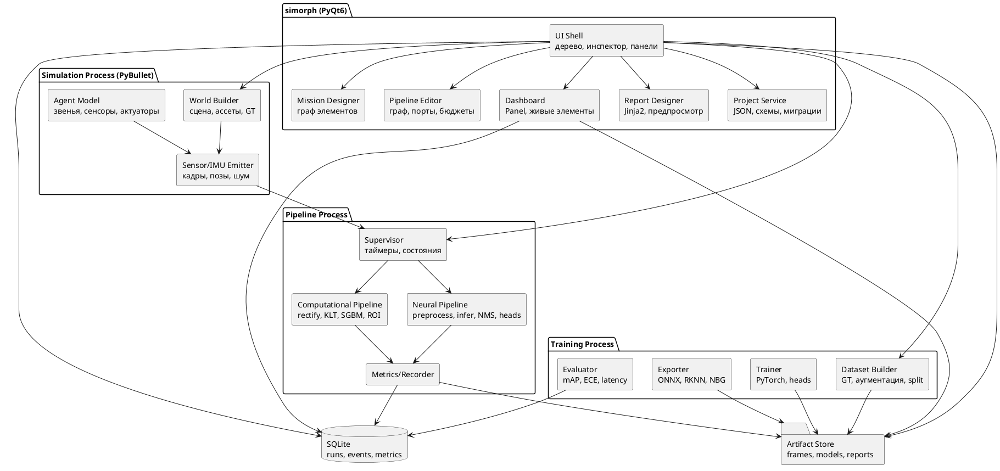
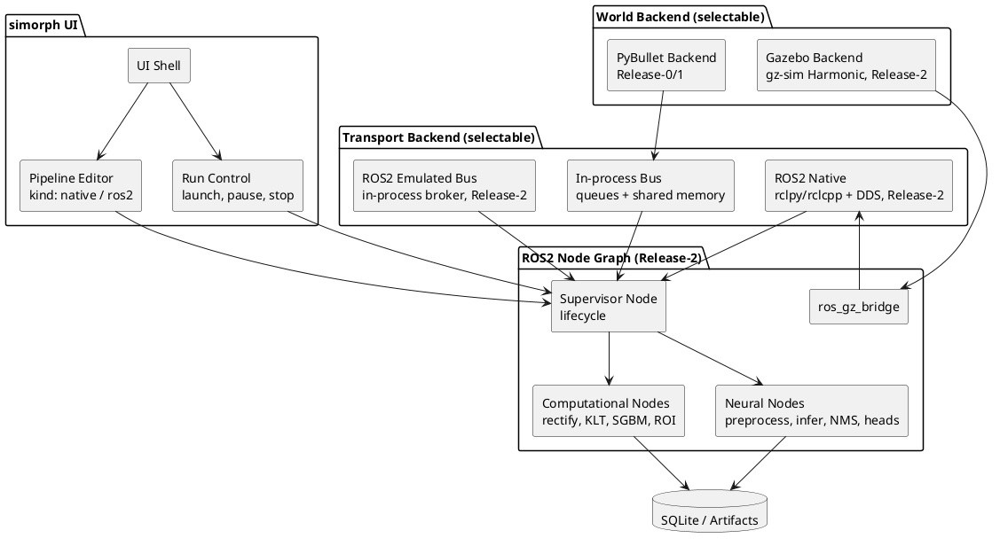

# TRD: simorph — настольная среда калибровки бортовых конвейеров патрульного робота

| Параметр | Значение |
|---|---|
| Идентификатор документа | `TRD-SIMORPH-1.0` |
| Версия | 1.0 |
| Статус | К реализации (MVP Definition) |
| Дата | 19.11.2026 |
| Основание | `TRD-ITMO-27.04.03-SWARM-DT-03`, `Initial_trd-1.md`, `Проработка.md`, пример программной оболочки `DataAggregor` |
| Стек | PyQt6, Python 3.13.7, PyBullet, OpenCV, NumPy, PyTorch, ONNX/OpenVINO, SQLite |
| Целевые ОС | Windows 10/11 — основная; Linux — вторичная |
| Целевые борта | RK3588 (RKNN), A733 (ACUITY/NBG) |
| Рабочая директория | `simorph/` |

---

## 0. Вводные положения

* Стек - PyQt6 + Python 3.13.7 + описанные в `Practice\_Проработка\Разные бортовые вычислители.md`
* Данная программа не должна реализовывать функционал командного контура, - она лишь калибрует конвейеры PC-прототипа.
* UseCase:

| Операция пользователя | Объект обучающей конфигурации | Элемент интерфейса |
|---|---|---|
| Внесение профиля объекта автоматизации (json-файл) либо его формирование в интерфейсе программы | Профиль заказчика | Окно профиля с json-редактором |
| Мир агента | 3D-модель | Окно с 3D-моделью мира (с флажком отключения фотореализма и колебаний среды) |
| Конфигурация агента | 3D-модель (без реализма) -> {Сенсоры, Актуаторы, Звенья} -> Параметры: {Сенсоры: {Входы, Выходы, Коэффициенты, Ограничения}, Звенья: {Длина, Ширина, Высота, Диаметр, Масса}} | Создание путем последовательного создания элементов в дереве либо путем загрузки в виде json |
| Формирование тестовых миссий | Упражнения -> (1:M) Миссии -> (1:M) Элементы | Окно расписания миссии (граф элементов), состоит из трех панелей: Левая - граф, средняя - элемент, правая - параметры, зависимости и тайминги. При выборе в дереве конфигурации отдельного элемента, окно содержит только панель элемента (правая) и панель параметров (левая) |
| Бортовая ЭВМ | Конвейеры (Вычислительный, Нейросетевой) | Окно исходников PC-прототипа: Слева - дерево директории с файлами модулей конвейера, справа - текст выбранного файла в синтаксической расцветке, но не редактируемый. Для отдельного редактирования используется ассоциированная в системе программа редактора кода |
| Логи и отчеты | DB-логи (SQLite) прогонов Упражнений, аналитические отчеты | Окно просмотра рядов данных в виде таблиц, Окно просмотра / конфигурирования аналитического отчета (Две панели: Слева редактируемый текст конфигурации отчета (сворачиваемый), справа - просмотр отчета) |

Примечание к сенсорам и актуаторам:
* Сенсор может быть типов: 9-осевой (углы Эйлера + Кватернион + полярная координата центра тяжести), GPS, Стереокамера 1280x800x8bit_mono@120Hz (стереопара), Камера 2560x1440x8bit_col@30Hz, Дистанции, Угла, Угловой скорости, Внешнего оборудования (цифровой, аналоговый), Сигнала ошибки (дискретный);
* Актуатор может быть типов: Поворотно-осевой, Продольный, Многозвенник, Реактивный вектор, Ведущая ось, Оптический фокус, Внешнее оборудование (цифровой, аналоговый).

### 0.1. Толкование вводных положений

1. **Программа — калибратор, а не стенд НИР.** `simorph` не заменяет `TRD-ITMO-27.04.03-SWARM-DT-03` и не реализует командный контур, эмуляцию бэкендов и корпоративные интеграции. ROS2 и Gazebo появляются только как режим калибровки в Release-2 (6.13). Назначение — собрать, проверить и откалибровать бортовой «разум» (супервизор + нейросетевой конвейер) на PC-прототипе до переноса на RK3588/A733.
2. **Профиль заказчика — вход, а не цель.** Профиль используется как источник параметров мира, агента, миссии и датасета. Экономика, право, договорные сроки и организационные роли в обучение не входят (классы Н из `Проработка.md`, 3.3.1).
3. **Исходники конвейера — read-only в приложении.** Окно исходников показывает дерево файлов и текст с подсветкой, но не редактирует его. Перестроение конвейера выполняется на уровне графа и параметров; изменение кода — во внешнем редакторе с последующей перевалидацией варианта.
4. **«Заливка на железо» — это экспорт пакета, а не прошивка.** В MVP приложение формирует воспроизводимый пакет (манифест, модели, конфигурация, скрипты конвертации) для RK3588/A733; запуск вендорских тулчейнов и кросс-компиляция — отдельный этап.
5. **ROS2 и Gazebo — Release-2, но швы закладываются сразу.** В Release-0/1 мир и транспорт работают на PyBullet и внутрипроцессной шине. В Release-2 добавляется конвейер типа `ros2` (супервизор и модули как ROS2-узлы), мир на Gazebo Harmonic и эмуляция архитектуры ROS2 в PC-прототипе. Чтобы переход не превратился в переписывание, абстракции `WorldBackend` и `TransportBackend` вводятся уже в Release-1.
6. **Масштаб времени — мягкий, бюджет ступени — плановый.** Симуляция не обязана укладываться в реальное время и не отбрасывает такты и кадры при нехватке производительности: время сцены растягивается, последовательность шагов сохраняется. Значения `budget_ms` и `fps` — плановые ориентиры для расчёта бюджета миссии, очередей и сравнения вариантов, а не ограничители исполнения. По каждому плановому интервалу фиксируются план и факт, поэтому по прогону видно, сколько времени потребовала PC-симуляция и какие ступени вышли за план (6.5.1).

---

## 1. Назначение, цели и границы

### 1.1. Назначение

`simorph` — настольное приложение для исследователя и инженера, которое позволяет:

1. загрузить или сформировать профиль объекта автоматизации и получить из него конфигурацию мира, агента и миссии;
2. погрузить бортовой «разум» (супервизор и нейросетевой конвейер) в синтетическую 3D-среду с управляемой степенью реализма и возмущений;
3. собрать типовой вычислительный и нейросетевой конвейеры из типовых элементов, проверить их совместимость и измерить бюджеты;
4. сгенерировать обучающий массив из прогонов, выполнить дообучение голов детекции, ключевых точек и эмбеддинга, откалибровать и квантизовать модель;
5. сохранить полный след прогона в SQLite, построить аналитический отчёт и экспортировать пакет для целевого борта.

### 1.2. Цели релиза

| ID | Цель | Измеримый результат |
|---|---|---|
| G-01 | Воспроизводимый проект | Один JSON-файл содержит профиль, мир, агента, упражнения, конвейеры и шаблоны отчётов |
| G-02 | Погружение «разума» | Супервизор и нейросетевой конвейер исполняются в синтетической сцене и получают кадры, GT и метки времени |
| G-03 | Перестроение конвейера | Вариант конвейера собирается из типовых элементов, валидируется и сравнивается по бюджету |
| G-04 | Дообучение | Голова детекции/ключевых точек/эмбеддинга дообучается на массиве из прогонов и оценивается по метрикам |
| G-05 | Прослеживаемость | Каждый прогон имеет `run_id`, хэш конфигурации, seed, версии и каталог артефактов |
| G-06 | Отчётность | Отчёт собирается по шаблону и экспортируется в Markdown/HTML/PDF |
| G-07 | Подготовка к железу | Пакет для RK3588/A733 содержит манифест, модели, конфигурацию и скрипты конвертации |
| G-08 | Повторяемость | Одинаковые seed, конфигурация и версии дают одинаковый мир и сопоставимые метрики |
| G-09 | ROS2-совместимость (Release-2) | Конвейер типа `ros2` исполняется в эмуляции ROS2 на PC и в нативном ROS2; мир собирается в Gazebo Harmonic |

### 1.3. Границы

**Входит в v1.0:**

- десктопный конфигуратор на PyQt6;
- проект как JSON-документ с версионированием и валидацией;
- профиль заказчика: импорт, редактирование, проекция в `P_gen`, `P_sim`, `P_hw`;
- 3D-мир на PyBullet: рельеф, зоны, упрощённые здания/установки/деревья/водоёмы, освещение, ветер, осадки;
- переключатели «фотореализм» и «колебания среды»;
- конфигуратор агента: звенья, сенсоры, актуаторы, связи, параметры, валидация;
- конструктор упражнений/миссий/элементов с графом и таймингами;
- исполнитель миссии (супервизор) с паузой, возобновлением и аварийным завершением;
- типовые вычислительный и нейросетевой конвейеры, графовый редактор вариантов, валидатор портов и бюджетов;
- просмотр исходников PC-прототипа в read-only режиме и открытие файла во внешнем редакторе;
- генерация датасета из прогонов, аугментация и доменная рандомизация;
- дообучение голов детекции, ключевых точек и эмбеддинга; калибровка и квантизация;
- SQLite-логи прогонов, табличный просмотр, экспорт CSV/Parquet;
- конструктор аналитического отчёта (слева — конфигурация, справа — предпросмотр);
- интерактивный дашборд прогона на Panel (HoloViz): метрики, LaTeX-формулы, живые ползунки и галочки;
- экспорт пакета для RK3588 и A733;
- CLI/headless-режим для пакетных прогонов и CI.

**Не входит в v1.0:**

- реализация командного контура, ГИС, BIM-сервера, ЭДО, BI и SSO/LDAP;
- Gazebo, ROS2, DDS, `ros_gz_bridge`, эмуляция базовых станций и бэкендов — **кроме** конвейера типа `ros2` и мира Gazebo, которые входят в Release-2 (раздел 6.13);
- обучение политики роя (аукцион, коалиции, Shapley, ACL-пайплайн) — это предмет стенда НИР, а не калибратора;
- управление реальными БПЛА/НРТК и жёсткий реальный масштаб времени;
- полноценная фотограмметрия и фотореалистичный рендер уровня Unity;
- кросс-компиляция и прошивка целевых плат «из коробки»;
- сертификация, промышленная эксплуатация и гарантии безопасности полётов;
- внешние BI-платформы и дашборд-сервисы (Grafana, Superset, Metabase): дашборд строится внутри приложения и работает offline.

**Входит в Release-2 (ROS2 и Gazebo):**

- конвейер типа `ros2`: супервизор, вычислительные и нейросетевые модули как ROS2-узлы;
- эмуляция архитектуры ROS2 в PC-прототипе: граф узлов, топики, сервисы, actions, параметры, lifecycle, QoS — без обязательной установки ROS2;
- нативный режим ROS2 (`rclpy`/`rclcpp`, DDS) на Linux и, при подтверждённой совместимости, на Windows;
- мир на Gazebo Harmonic (gz-sim) с SDF и `ros_gz_bridge` как альтернативный `WorldBackend`;
- перенос калибровочных прогонов между PyBullet и Gazebo с фиксацией расхождений;
- запись и воспроизведение rosbag2-подобного потока в рамках `simorph`.

### 1.4. Отношение к исходным документам

| Источник | Что берётся | Что не берётся |
|---|---|---|
| `WholeTRD.md` (v0.3) | Векторы `P_gen`, `P_sim`, `P_hw`; формат миссии; метрики нагрузки; «швы» `InferenceBackend`, `RoiChannel`, `monotonic_ns`; целевые борта RK3588/A733; ROS2-топики и QoS как контракт Release-2 | Gazebo/ROS2 — только в объёме Release-2 (6.13); C++-плагины возмущений, бэкенды, корпоративные интеграции, ACL-пайплайн как обучение роя |
| `Initial_trd-1.md` | Метрики `T_react`, `P_miss`, `Q_guar`, `E_drain`; модель задачи `τ_k`; дисциплина воспроизводимости | Реализация кооперативного аукциона и коалиций; это контекст миссии, а не код калибратора |
| `Проработка.md` | Состав сенсоров/актуаторов; конвейер RK3588 + 2×OV9281; границы бортовой НС; оси дообучения; формат миссии; PC-прототип на PyBullet | Командный контур, ГИС/BIM, правовой блок, ТЭО |
| `DataAggregor` | Паттерны оболочки: дерево объектов, инспектор, трёхпанельные редакторы, JSON-проект, SQLite-журналы, настройки через `QSettings` | Предметная область и код проекта |

### 1.5. Ключевые принципы

1. **Проект — переносимый JSON.** Исполнение — интерпретация проекта; артефакты прогона — производные.
2. **UI вне горячего контура.** Рендер, инференс и обучение живут в отдельных процессах; интерфейс не блокируется.
3. **Конвейер — граф с типизированными портами.** Перестроение — композиция и параметры, а не правка кода внутри приложения.
4. **Источник весов — ONNX.** RKNN и NBG собираются из него; PC-бэкенд — OpenVINO.
5. **Offline-first.** Базовый режим не делает внешних сетевых запросов; NDA-ассеты — в отдельном хранилище.
6. **Бэкенды мира и транспорта заменяемы.** PyBullet и Gazebo, `inproc` и ROS2 — реализации одного контракта; смена режима не меняет миссию и граф конвейера.
7. **Полнота потока важнее реального времени.** Шаг и кадр не пропускаются; масштаб времени измеряется и попадает в метрики, поэтому замедление PC видно, а не скрыто.

---

## 2. Термины и сокращения

| Термин | Значение |
|---|---|
| simorph | Настольная среда калибровки бортовых конвейеров патрульного робота |
| Профиль | JSON-описание объекта автоматизации и условий эксплуатации (подмножество 75 параметров `Проработка.md`) |
| `P_gen` | Вектор параметров генерации мира (геометрия, здания, установки, инфраструктура, ассеты) |
| `P_sim` | Вектор параметров симуляции (время, атмосфера, катастрофы, рой, связь, обучение) |
| `P_hw` | Вектор бортовых констант (динамика, сенсоры, вычисления, энергия, связь) |
| Упражнение | Набор миссий с общим seed, средой и составом агентов |
| Миссия | Граф элементов, выполняемый одним агентом или группой |
| Элемент | Узел миссии: старт, переход, наблюдение, зависание, включение сенсора, возврат, аварийное завершение |
| Супервизор | Программа-оркестратор: таймеры, очередь, состояния, события, прогноз на `t0 + Δt` |
| Конвейер | Направленный граф модулей обработки данных с типизированными портами и бюджетами |
| Вычислительный конвейер | Конвейер геометрии и трекинга: ректификация, KLT, разреженная/плотная стерео, ROI, слияние |
| Нейросетевой конвейер | Конвейер инференса: препроцессинг, `InferenceBackend.infer()`, NMS, головы детекции/ключевых точек/эмбеддинга |
| PC-прототип | Реализация конвейера на ПК с «швами» переноса на борт |
| Целевой борт | RK3588 (RKNN, 6 TOPS) или A733 (ACUITY, 3 TOPS) |
| RKNN | Формат и runtime нейросетей Rockchip |
| ACUITY / NBG | Тулчейн и формат нейросетей Allwinner |
| ONNX | Единый формат обмена весами |
| GT | Ground truth: глубина, маски, позы, ключевые точки из сцены |
| ROI | Region of Interest, кроп-канал |
| PoI | Point of Interest, элемент внимания |
| KLT | Kanade–Lucas–Tomasi, оптический поток |
| SGBM | Semi-Global Block Matching, плотная стереокарта |
| FSIN | Аппаратный импульс синхронизации кадров |
| ECE | Expected Calibration Error, калибровка уверенности |
| FPPI | False Positives Per Image |
| NDA | Соглашение о конфиденциальности; режим защищённого импорта ассетов |
| Прогон (run) | Один запуск упражнения/миссии/конвейера с фиксированными seed и конфигурацией |
| Артефакт | Файл прогона: кадры, облака, логи, метрики, модель, отчёт |
| Манифест | Машиночитаемое описание версий, хэшей, seed и состава пакета |
| Доменная рандомизация | Вариативность сенсоров, среды и сцен для устойчивости модели |
| Curriculum (сенсорный) | Расписание усложнения условий видимости и деградации сенсора |
| QAT | Quantization-Aware Training, обучение с учётом квантизации |
| ROS2 | Robot Operating System 2; в simorph — тип конвейера и транспортный режим (Release-2) |
| DDS | Data Distribution Service, транспортный слой ROS2 |
| QoS | Quality of Service, политики доставки сообщений ROS2 |
| rclpy / rclcpp | Клиентские библиотеки ROS2 для Python и C++ |
| Gazebo Harmonic | gz-sim, физический симулятор; альтернативный `WorldBackend` (Release-2) |
| SDF | Simulation Description Format, формат описания мира Gazebo |
| `ros_gz_bridge` | Мост между топиками Gazebo и ROS2 |
| World Backend | Абстракция источника мира и сенсоров: PyBullet или Gazebo |
| Transport Backend | Абстракция транспорта: внутрипроцессная шина, эмуляция ROS2 или нативный ROS2 |
| ROS2-эмуляция | Совместимый по API граф узлов и топиков без DDS; детерминированный режим для PC и CI |
| Lifecycle-узел | ROS2-узел с управляемыми состояниями: configure, activate, deactivate, cleanup |
| ADR | Architecture Decision Record |
| Мягкий масштаб времени | Режим исполнения, при котором приложение не пропускает такты и кадры, а растягивает время сцены при нехватке производительности |
| Коэффициент масштаба | Отношение фактического времени PC к плановому времени сцены на интервале наблюдения |
| Плановый интервал | Целевой период ступени конвейера (`budget_ms`, `fps`); ориентир для бюджета миссии и статистики, а не жёсткий лимит исполнения |
| Дашборд | Интерактивный отчёт прогона с живыми элементами (ползунки, галочки, выбор прогона) и LaTeX-формулами |
| Panel (HoloViz) | Библиотека дашбордов на Bokeh/Param; основа интерактивных отчётов simorph |

---

## 3. Роли и сценарии использования

### 3.1. Роли

| Роль | Задачи |
|---|---|
| Инженер-исследователь | Собирает упражнения, запускает прогоны, сравнивает варианты конвейера |
| Инженер по данным/ML | Готовит датасет, дообучает головы, калибрует и квантизует модель |
| Инженер по бортовым системам | Настраивает агента, сенсоры, актуаторы, бюджеты и целевой пакет |
| Научный руководитель / приёмка | Проверяет воспроизводимость, отчёты и соответствие требованиям |

### 3.2. Сценарии использования

| ID | Сценарий | Актор | Результат |
|---|---|---|---|
| UC-01 | Импорт профиля из JSON или формирование в редакторе | Исследователь | Валидный профиль, спроецированный в `P_gen`, `P_sim`, `P_hw` |
| UC-02 | Просмотр мира и переключение фотореализма/колебаний | Исследователь | Сцена с GT, камерами и управляемой деградацией |
| UC-03 | Конфигурация агента | Инженер борта | Дерево звеньев, сенсоров, актуаторов и связей; валидная модель |
| UC-04 | Формирование упражнения и миссии | Исследователь | Граф элементов с таймингами и зависимостями |
| UC-05 | Просмотр и перестроение конвейера | Инженер борта | Вариант конвейера, прошедший валидацию портов и бюджетов |
| UC-06 | Прогон упражнения | Исследователь | Кадры, GT, события, метрики, `run_id` |
| UC-07 | Дообучение и оценка модели | Инженер ML | Чекпойнт, метрики, ONNX/RKNN/NBG-артефакт |
| UC-08 | Отчёт и экспорт на железо | Исследователь | Отчёт и пакет для RK3588/A733 |

### 3.3. Сквозной сценарий

1. Открыть проект или создать новый.
2. Импортировать профиль; проверить классы параметров (С/Э/М/Н) и проекцию в векторы.
3. Собрать мир; проверить сцену, камеры и GT.
4. Создать агента (НРТК или БВС); добавить звенья, сенсоры, актуаторы, связи.
5. Создать упражнение → миссию → элементы; проверить граф и тайминги.
6. Выбрать вариант вычислительного и нейросетевого конвейера; проверить порты и бюджеты.
7. Запустить прогон; наблюдать сцену, события и метрики в реальном времени.
8. Открыть логи; сформировать датасет; выполнить дообучение и оценку.
9. Сравнить варианты конвейера и модели; зафиксировать лучший.
10. Сформировать отчёт и экспортировать пакет для целевого борта.

### 3.4. Ограничения сценариев

- Базовый режим не требует сети; все данные — локальные.
- NDA-ассеты доступны только через отдельный каталог/хранилище и не попадают в общий датасет без явного разрешения.
- Прогон можно остановить, поставить на паузу и возобновить; аварийное завершение не повреждает артефакты.
- «Заливка» в MVP — экспорт пакета; фактическая прошивка и кросс-компиляция выполняются вне приложения.

---

## 4. Архитектура

### 4.1. Логическая архитектура



### 4.1.1. Целевая архитектура Release-2: ROS2 и Gazebo



Три режима транспорта различаются только реализацией `TransportBackend`, граф узлов и контракты топиков сохраняются:

| Режим | Реализация | Назначение |
|---|---|---|
| `inproc` | Очереди и shared memory | Release-0/1, минимальные накладные расходы |
| `ros2_emulated` | Внутрипроцессный брокер с API `rclpy`-подобного слоя | Release-2, PC и CI без установленного ROS2; детерминизм |
| `ros2_native` | `rclpy`/`rclcpp`, DDS | Release-2, проверка на реальном стеке; Linux — основной, Windows — при подтверждённой совместимости |

`WorldBackend` и `TransportBackend` — точки расширения: добавление Gazebo или нового DDS-вендора не меняет код супервизора, конвейеров и метрик.

### 4.2. Процессы и изоляция

| Процесс | Назначение | Изоляция | Обмен |
|---|---|---|---|
| UI | PyQt6-интерфейс, проект, редакторы | Главный процесс | Очереди команд/событий, SQLite |
| Simulation | PyBullet, сцена, камеры, IMU, GT | Отдельный процесс | `multiprocessing.Queue`, shared memory для кадров |
| Pipeline | Супервизор, вычислительный и нейросетевой конвейеры | Отдельный процесс | Очереди, shared memory, метрики |
| Training | Датасет, обучение, оценка, экспорт | Отдельный процесс | JSON-lines, файлы, отмена через `Event` |
| Storage | SQLite и артефакты | Отдельный поток/процесс | WAL, транзакции |
| Dashboard | Дашборд на Panel (HoloViz), сервер на `127.0.0.1` | Отдельный процесс | HTTP/WebSocket в браузер или `QWebEngineView` |
| Simulation (Gazebo) | gz-sim, SDF, сенсоры, `ros_gz_bridge` | Отдельные процессы (Release-2) | ROS2-топики, DDS |
| ROS2 Nodes | Супервизор и модули как узлы графа | Отдельные процессы или компоненты (Release-2) | DDS или эмуляция |
| Transport | `inproc`, `ros2_emulated`, `ros2_native` | Слой между процессами | Очереди, shared memory, DDS |

Падение симуляции или обучения не должно завершать UI: прогон помечается `interrupted`, артефакты сохраняются, пользователь получает диагностику. В режиме `ros2_native` падение отдельного узла не останавливает граф: супервизор фиксирует потерю heartbeat и переводит миссию в состояние `degraded`.

### 4.3. Компоненты

| Компонент | Ответственность |
|---|---|
| UI Shell | Главное окно, дерево проекта, инспектор, вкладки, темы, горячие клавиши |
| Project Service | Схемы JSON, валидация, миграции, хэширование, автосохранение |
| Profile Service | Импорт/экспорт профиля, классы С/Э/М/Н, проекция в векторы |
| World Service | Сборка сцены PyBullet, ассеты, освещение, ветер, осадки, GT |
| Agent Service | Звенья, сенсоры, актуаторы, связи, URDF-подобная модель, валидация |
| Mission Service | Упражнения/миссии/элементы, граф, тайминги, исполнитель |
| Pipeline Service | Граф конвейера, порты, параметры, валидатор, варианты, сравнение |
| Simulation Runtime | Часы, шаг, пауза, масштаб времени, синхронизация кадров |
| Training Service | Датасет, аугментация, обучение, оценка, калибровка, квантизация |
| Report Service | Шаблоны Jinja2, метрики, графики, экспорт MD/HTML/PDF |
| Dashboard Service | Интерактивный отчёт на Panel: живые элементы, LaTeX, источник — Python-файл |
| Deployment Service | Целевые профили, манифест, скрипты конвертации, checksums |
| Storage Service | SQLite, артефакты, индексы, очистка, резервное копирование |
| CLI | Headless-прогоны, пакетные серии, экспорт, проверка проекта |
| World Backend | Единый интерфейс мира и сенсоров; реализации `pybullet` и `gazebo` |
| Transport Service | Единый интерфейс обмена; реализации `inproc`, `ros2_emulated`, `ros2_native` |
| ROS2 Adapter | Генерация launch-файлов, QoS-профилей, маппинга топиков и параметров узлов (Release-2) |

### 4.4. Потоки данных

**Поток кадров.** `Sensor Emitter → shared memory (ring buffer 2–4 кадра) → Pipeline Process → Computational/Neural → Metrics/Recorder`. Кадр несёт `frame_id`, `t_fsin_ns`, `t_monotonic_ns`, `camera_id`, `exposure_us`.

**Поток управления.** `UI → Mission Service → Supervisor → Agent Model → PyBullet`. Команды: старт, пауза, продолжение, стоп, смена элемента, аварийный возврат.

**Поток метрик.** `Pipeline/Simulation → Metrics → SQLite (батчами) + Parquet/CSV`. Метрики не пишутся в UI-потоке.

**Поток обучения.** `Run artifacts → Dataset Builder → Trainer → Evaluator → Exporter → Artifact Store + SQLite`.

**Поток ROS2 (Release-2).** `Gazebo → ros_gz_bridge → DDS → узлы конвейера → супервизор → события и метрики`. В режиме `ros2_emulated` тот же граф исполняется на внутрипроцессном брокере: имена топиков, типы сообщений, QoS и lifecycle-переходы совпадают с нативным режимом, поэтому конфигурация переносится без изменений.

**Поток параметров.** `UI → ROS2 Adapter → parameter services / YAML → узлы`. Изменение параметра на лету допускается только для узлов, объявивших его динамическим; остальные требуют перезапуска узла.

**Поток отчёта и дашборда.** `SQLite/Parquet → Report Service (Jinja2) → MD/HTML/PDF` и параллельно `SQLite/Parquet → Dashboard Service (Panel) → локальный сервер 127.0.0.1 → браузер`. Дашборд читает только сохранённые артефакты и не участвует в горячем контуре.

### 4.5. Ключевые архитектурные решения

| ID | Решение | Обоснование | Следствие |
|---|---|---|---|
| ADR-01 | PyBullet как рендер/физика | Детерминизм, GT, скорость, Python-нативность | Нет фотореализма уровня Unity; компенсируется материалами и шумом |
| ADR-02 | UI вне горячего контура | Отзывчивость и изоляция сбоев | Обмен только через очереди/shared memory |
| ADR-03 | Проект — JSON, прогоны — SQLite | Переносимость и прослеживаемость | Схемы и миграции обязательны |
| ADR-04 | Конвейер — DAG с типизированными портами | Безопасное перестроение без правки кода | Валидатор портов и бюджетов |
| ADR-05 | Исходники read-only, внешний редактор | Защита от случайных правок и воспроизводимость | Хэш файлов и статус `stale` |
| ADR-06 | ONNX — единый источник весов | Переносимость PC → RKNN/NBG | Конвертация и квантизация отдельными шагами |
| ADR-07 | Целевые профили — данные | Добавление нового борта без кода | `targets/*.yaml` и манифест |
| ADR-08 | Offline-first | Требования NDA и изолированного контура | Нет телеметрии и внешних API в базовом режиме |
| ADR-09 | `WorldBackend` как абстракция с Release-1 | Переход PyBullet → Gazebo без переписывания супервизора и конвейеров | Два бэкенда мира, общий контракт сенсоров и GT |
| ADR-10 | `TransportBackend` как абстракция с Release-1 | Один граф конвейера в `inproc`, эмуляции ROS2 и нативном ROS2 | Контракты топиков и QoS фиксируются до Release-2 |
| ADR-11 | ROS2-эмуляция в PC-прототипе | Калибровка и CI на Windows без установленного ROS2 | Детерминированный брокер; нативный режим — проверочный, не обязательный для повседневной работы |
| ADR-12 | Panel (HoloViz) как библиотека дашбордов | Легче Dash, живые элементы работают без полного перезапуска скрипта (в отличие от Streamlit), есть LaTeX-панель, источник — обычный Python-файл | Зависимость от Bokeh; встраивание через `QWebEngineView` опционально, базовый режим — локальный сервер и системный браузер |
| ADR-13 | Мягкий масштаб времени без пропусков | Полнота потока важнее реального времени: пропуск такта искажает метрики калибровки | Прогон может идти медленнее реального времени; масштаб измеряется и попадает в метрики и отчёт |

### 4.6. Соответствие требованиям исходных документов

| Требование исходного TRD | Покрытие в simorph | Раздел |
|---|---|---|
| FR-GEN-01…FR-GEN-20 | Частично: генерация упрощённого мира из профиля, seed, манифест, локальные ассеты | 6.2, 6.3 |
| FR-AST-01…FR-AST-10 | Частично: локальная библиотека примитивов и упрощённых ассетов | 6.3 |
| FR-DRN-01…FR-DRN-13 | Частично: конфигурация агента, сенсоры, актуаторы, телеметрия, нагрузка | 6.4, 6.6 |
| FR-SIM-01…FR-SIM-16 | Частично: сцена, время, ветер, осадки, пауза; Gazebo/ROS2 — в Release-2 (6.13) | 6.5, 6.13 |
| FR-SIM/FR-NET (ROS2-транспорт) | Частично: ROS2-топики, QoS, базовые станции как источник событий — Release-2 | 6.13, 8.8 |
| FR-TEL-01…FR-TEL-10 | Частично: SQLite-логи, метрики, OSD-подобные оверлеи, `run_id` | 6.8 |
| FR-UI-01…FR-UI-08 | Частично: граф агентов, снимки состояния, аннотации; без матриц полезности роя | 6.4, 6.7 |
| FR-TRN-01…FR-TRN-07 | Частично: датасет, curriculum по условиям сенсора, seed, YAML | 6.7 |
| FR-REP-01…FR-REP-07 | Частично: MD/HTML/PDF, сравнение прогонов, шаблоны, git-хэш | 6.9 |
| FR-INT-01…FR-INT-08 | Не входит | 1.3 |
| NFR-PERF, NFR-REL, NFR-REP | Частично, с собственными порогами | 7 |

---

## 5. Модель данных и форматы

### 5.1. Project JSON

```json
{
  "schema_version": "1.0",
  "project_id": "uuid",
  "name": "NKZ-calibration",
  "created_at": "2026-11-19T10:00:00Z",
  "profile": { "path": "profiles/nkz.json", "hash": "sha256:..." },
  "world": { "seed": 42, "preset": "industrial_lite", "assets_root": "assets/", "backend": "pybullet" },
  "agents": [ { "id": "NRTC-01", "role": "rover" } ],
  "exercises": [ { "id": "EX-01", "missions": [ "M-01" ] } ],
  "pipelines": [ { "id": "PIPE-CMP-01", "kind": "computational" } ],
  "transport": { "mode": "inproc", "domain_id": 0 },
  "reports": [ { "id": "REP-01", "template": "templates/run_report.j2" } ],
  "dashboards": [ { "id": "DASH-01", "source": "reports/dash_run.py", "config": "reports/dash_run.yaml" } ],
  "settings": { "theme": "dark", "language": "ru", "offline": true }
}
```

### 5.2. Профиль

Профиль — JSON с параметрами, сгруппированными по блокам A–J (`Проработка.md`, 3.3.2). Каждый параметр имеет:

- `id` (например, `П-06`);
- `value` или `range`;
- `class` — `C` (синтез геометрии), `E` (эмуляция), `M` (метаданные прогона), `N` (не воспроизводится);
- `target` — целевой вектор (`P_gen`, `P_sim`, `P_hw`) или `null`;
- `source` — анкета/документ/обход;
- `comment`.

Валидатор проверяет: обязательные поля, диапазоны, согласованность единиц, классы, проекцию. Параметры класса `N` сохраняются, но не участвуют в генерации и обучении.

### 5.3. Мир

```json
{
  "world_id": "W-01",
  "seed": 42,
  "terrain": { "size_m": [2000, 2000], "elevation_m": [0, 12], "mesh": "terrain.obj" },
  "zones": [ { "id": "Z-01", "polygon": [[0,0],[500,0],[500,400],[0,400]], "kind": "tech" } ],
  "buildings": [ { "id": "B-01", "zone": "Z-01", "footprint": [40, 25], "floors": 3 } ],
  "equipment": [ { "id": "E-01", "class": "pump", "pose": [120, 80, 0], "height_m": 2.4 } ],
  "trees": [ { "id": "T-01", "pose": [300, 220, 0], "height_m": 8 } ],
  "water": [ { "id": "W-01", "polygon": [[600,600],[700,600],[700,700],[600,700]] } ],
  "lighting": { "sun_azimuth_deg": 135, "sun_elevation_deg": 40, "cloudiness": 0.3 },
  "wind": { "speed_mps": 4.0, "direction_deg": 90, "gust_model": "dryden" }
}
```

Мир в MVP — упрощённая сцена PyBullet, а не полный SDF-мир Gazebo. Импорт `world_manifest.yaml` из генератора НИР допускается как источник геометрии; в MVP — без ROS2/Gazebo-плагинов, в Release-2 тот же манифест используется бэкендом Gazebo.

### 5.4. Агент

```json
{
  "agent_id": "NRTC-01",
  "role": "rover",
  "links": [
    { "id": "base", "type": "box", "size_m": [1.2, 0.8, 0.4], "mass_kg": 45, "pose": [0,0,0.2] }
  ],
  "joints": [
    { "id": "wheel_fl", "parent": "base", "child": "wheel_fl", "type": "continuous", "axis": [0,1,0] }
  ],
  "sensors": [
    { "id": "cam_stereo", "type": "stereo_camera", "link": "base", "rate_hz": 120,
      "resolution": [1280, 800], "bit_depth": 8, "mode": "mono", "baseline_m": 0.12 }
  ],
  "actuators": [
    { "id": "drive", "type": "drive_axis", "joint": "wheel_fl", "max_speed_rad_s": 20, "max_torque_nm": 8 }
  ],
  "links_comm": [
    { "id": "wifi", "type": "wifi6", "bandwidth_mbps": 50, "latency_ms": 5, "loss": 0.01 }
  ]
}
```

### 5.4.1. Бортовые константы `P_hw`

Конфигуратор агента хранит константы классами `TC-*` и отображает их в инспекторе. Полный перечень — в `TRD-ITMO-27.04.03-SWARM-DT-03`, раздел 8.13; в `simorph` используются следующие группы:

| ID | Константа | Ед. изм. | Подстраиваемая |
|---|---|---|---|
| TC-DYN-01 | Масса дрона с нагрузкой | кг | да |
| TC-DYN-02 | Моменты инерции `Ixx, Iyy, Izz` | кг·м² | да |
| TC-DYN-03 | Максимальная тяга мотора | Н | да |
| TC-DYN-04 | Передаточная функция мотора | с | да |
| TC-DYN-05 | Максимальная линейная скорость | м/с | да |
| TC-DYN-06 | Максимальное линейное ускорение | м/с² | да |
| TC-DYN-07 | Максимальная угловая скорость | рад/с | да |
| TC-DYN-08 | Коэффициент аэродинамического сопротивления | — | да |
| TC-DYN-09 | Плечо мотора | м | нет |
| TC-SEN-01 | Разрешение камеры | px | да |
| TC-SEN-02 | Частота кадров камеры | Гц | да |
| TC-SEN-03 | Угол обзора (FOV) | град | да |
| TC-SEN-04 | Шум гироскопа | рад/с | да |
| TC-SEN-05 | Шум акселерометра | м/с² | да |
| TC-SEN-06 | Задержка сенсоров | мс | да |
| TC-SEN-07 | Максимальная дальность детекции | м | да |
| TC-CMP-01 | Бюджет CPU на цикл управления | мс | да |
| TC-CMP-02 | Бюджет GPU на цикл восприятия | мс | да |
| TC-CMP-03 | Размер буфера кадров | кадры | да |
| TC-CMP-04 | Частота контроллера стабилизации | Гц | да |
| TC-CMP-05 | Частота контура планирования | Гц | да |
| TC-CMP-06 | Порог переключения heavy/light | мс | да |
| TC-CMP-07 | PID roll/pitch | vec3 | да |
| TC-CMP-08 | PID yaw | vec3 | да |
| TC-CMP-09 | Максимальный размер очереди команд | шт. | да |
| TC-ENE-01 | Ёмкость батареи | Вт·ч | да |
| TC-ENE-02 | Потребление в режиме hover | Вт | да |
| TC-ENE-03 | Потребление при максимальной тяге | Вт | да |
| TC-ENE-04 | Потребление бортовой ЭВМ | Вт | да |
| TC-ENE-05 | Порог критического заряда | % | да |
| TC-COM-01 | Пропускная способность канала | Мбит/с | да |
| TC-COM-02 | Базовая задержка канала | мс | да |
| TC-COM-03 | MTU пакета | байт | нет |
| TC-COM-04 | Размер буфера повторной передачи | шт. | да |
| TC-COM-05 | Порог потери связи (timeout) | мс | да |

### 5.5. Сенсоры

| Тип | Параметры | Выходы |
|---|---|---|
| 9-осевой | rate_hz, range, noise, bias, latency_ms | углы Эйлера, кватернион, полярная координата ЦМ |
| GPS | rate_hz, accuracy_m, latency_ms | широта, долгота, высота, скорость |
| Стереокамера 1280×800×8 mono @120 Гц | rate_hz, baseline_m, fov_deg, exposure_us, noise, sync | левый/правый кадр, `t_fsin_ns`, GT-глубина |
| Камера 2560×1440×8 col @30 Гц | rate_hz, fov_deg, exposure_us, noise | RGB-кадр, `t_fsin_ns` |
| Дистанции | rate_hz, range_m, noise | расстояние до препятствия |
| Угла | rate_hz, range_deg, noise | угол |
| Угловой скорости | rate_hz, range_dps, noise | угловая скорость |
| Внешнее оборудование (цифровой/аналоговый) | rate_hz, channels, levels | дискретные/аналоговые значения |
| Сигнал ошибки (дискретный) | rate_hz, active_level | флаг ошибки |

### 5.6. Актуаторы

| Тип | Параметры | Вход |
|---|---|---|
| Поворотно-осевой | range_deg, max_speed_dps, max_torque_nm, response_ms | угол/скорость |
| Продольный | range_m, max_speed_mps, max_force_n, response_ms | позиция/скорость |
| Многозвенник | joints[], lengths_m, max_torque_nm[], response_ms | суставные углы |
| Реактивный вектор | thrust_max_n, gimbal_deg, response_ms | тяга/вектор |
| Ведущая ось | max_speed_rad_s, max_torque_nm, response_ms | скорость/момент |
| Оптический фокус | range_m, max_speed, response_ms | фокус |
| Внешнее оборудование | channels, levels, response_ms | цифровой/аналоговый сигнал |

### 5.7. Упражнение, миссия, элемент

```json
{
  "exercise_id": "EX-01",
  "seed": 42,
  "world_id": "W-01",
  "agents": ["NRTC-01"],
  "missions": [
    {
      "mission_id": "M-01",
      "agent_id": "NRTC-01",
      "elements": [
        { "id": "start", "type": "start", "next": ["wp-1"] },
        { "id": "wp-1", "type": "waypoint", "pose": [100, 50, 0], "speed_mps": 1.2, "next": ["obs-1"] },
        { "id": "obs-1", "type": "observe", "zone": "Z-01", "sensor": "cam_stereo",
          "duration_s": 20, "ttl_s": 90, "priority": 1, "next": ["ret-1"] },
        { "id": "ret-1", "type": "return_to_base", "next": [] }
      ]
    }
  ]
}
```

Типы элементов MVP: `start`, `waypoint`, `transit`, `observe`, `dwell`, `activate_sensor`, `capture`, `return_to_base`, `abort`, `loop`, `parallel`, `condition`. Граф — DAG; циклы допускаются только через `loop` с явным лимитом итераций.

### 5.8. Конвейер

```json
{
  "pipeline_id": "PIPE-NN-01",
  "kind": "neural",
  "variant": "rk3588-int8",
  "nodes": [
    { "id": "src", "type": "source.frame", "params": { "camera": "cam_stereo", "fps": 120 } },
    { "id": "pre", "type": "preprocess", "params": { "size": [640, 640], "layout": "nchw" } },
    { "id": "inf", "type": "inference", "params": { "backend": "openvino", "model": "det_kp.onnx" },
      "budget_ms": 400 },
    { "id": "nms", "type": "postprocess.nms", "params": { "iou": 0.45, "conf": 0.25 } },
    { "id": "det", "type": "head.detection", "params": { "classes": "classes.json" } },
    { "id": "kp", "type": "head.keypoints", "params": { "k": 6 } },
    { "id": "sink", "type": "sink.events", "params": { "topic": "events" } }
  ],
  "edges": [
    { "from": "src.frame", "to": "pre.image" },
    { "from": "pre.tensor", "to": "inf.input" },
    { "from": "inf.output", "to": "nms.input" },
    { "from": "nms.dets", "to": "det.input" },
    { "from": "det.dets", "to": "kp.input" },
    { "from": "kp.events", "to": "sink.events" }
  ]
}
```

Типы портов: `image`, `stereo_pair`, `tensor`, `points2d`, `points3d`, `depth`, `detections`, `keypoints`, `embedding`, `pose`, `events`, `metrics`. Валидатор проверяет совместимость портов, обязательные входы, отсутствие циклов (кроме `loop`), бюджеты и доступность модели.

`budget_ms` ступени — плановый ориентир, а не ограничитель. Валидатор сравнивает сумму бюджетов с плановым интервалом и предупреждает о перерасходе, но исполнение не прерывает и кадры не отбрасывает: при нехватке производительности растягивается время сцены (6.5.1). Отбрасывание кадров включается только явным режимом `realtime_drop`.

### 5.8.1. Типовые конвейеры

**Вычислительный конвейер** (геометрия и трекинг):

1. `source.stereo` — синхронная стереопара 1280×800×8 mono, до 120 Гц, общий FSIN.
2. `rectify` — `remap` по предвычисленным картам; карты считаются один раз при старте.
3. `sparse.detect` — редкий детектор точек (`goodFeaturesToTrack`).
4. `sparse.track` — KLT 15×15, 200–400 точек, 120 Гц.
5. `sparse.stereo` — горизонтальный `matchTemplate`, `Z = f·B/d`, left-right check.
6. `dense.stereo` — SGBM + WLS, 1–4 с, только для NPU-транзакции.
7. `roi` — кропы PoI, координатная квантизация кратна 2 (совместимость с RGA).
8. `fusion` — слияние треков, облака, позы и зон.
9. `event` — события и метрики.
10. `sink` — запись, телеметрия, артефакты.

**Нейросетевой конвейер** (семантика):

1. `source.frame` или `source.roi`.
2. `preprocess` — resize, normalize, letterbox.
3. `inference` — `InferenceBackend.infer()`; на PC — OpenVINO, на борте — RKNN/ACUITY.
4. `postprocess.nms` — NMS на CPU.
5. `head.detection` — `class_id`, `bbox`, `conf`.
6. `head.keypoints` — K характерных точек.
7. `head.embedding` — re-ID.
8. `fusion` — сопоставление с треками и зонами.
9. `sink` — события и метрики.

**Что можно перестраивать без правки кода:** порядок узлов, состав голов, backend, разрешение и fps, размер ROI, бюджеты, размеры очередей, привязку к ядрам, набор моделей. **Что требует внешней правки:** реализация модуля, новые типы портов, новые операторы модели. После внешней правки вариант помечается `stale` и требует перевалидации.

**ROS2-конвейер (Release-2, `kind: ros2`).** Тот же граф, но каждый узел разворачивается как ROS2-узел или компонент, а рёбра становятся топиками, сервисами или actions:

| Элемент графа | ROS2-представление |
|---|---|
| `source.stereo` / `source.frame` | publisher `sensor_msgs/Image`, `sensor_msgs/CameraInfo` |
| `rectify`, `preprocess` | component-узел, подписка/публикация `Image` |
| `sparse.track` | узел с публикацией `Points2D`-подобного сообщения и метрик |
| `dense.stereo` | узел с публикацией `sensor_msgs/PointCloud2` |
| `inference` | component-узел, сервис `infer` или action для длинных запросов |
| `head.*` | узлы-головы с собственными параметрами |
| `fusion`, `event` | узел-агрегатор, публикация событий |
| `sink` | подписчик записи и метрик |
| супервизор | lifecycle-узел: `configure → activate → deactivate → cleanup` |

Маппинг имён топиков, QoS и параметров хранится в `qos_profiles.yaml` и `ros2_topics.yaml`; вариант конвейера экспортируется в `launch.py`. В режиме `ros2_emulated` те же файлы интерпретируются внутрипроцессным брокером без DDS.

Требования к ROS2-конвейеру: имена и типы сообщений не хардкодятся в модулях; QoS задаётся профилем, а не кодом; узел обязан объявлять параметры и heartbeat; потеря узла обнаруживается супервизором за `heartbeat_timeout_ms`.

### 5.9. SQLite-схема

| Таблица | Назначение | Ключевые поля |
|---|---|---|
| `runs` | Прогоны | `run_id`, `project_hash`, `exercise_id`, `mission_id`, `seed`, `started_at`, `finished_at`, `status`, `artifact_dir` |
| `run_events` | События прогона | `id`, `run_id`, `t_ns`, `source`, `type`, `payload_json` |
| `metrics` | Ряды метрик | `id`, `run_id`, `name`, `value`, `unit`, `t_ns`, `tags_json` |
| `artifacts` | Артефакты | `id`, `run_id`, `kind`, `path`, `hash`, `size_bytes` |
| `annotations` | Разметка | `id`, `run_id`, `frame_id`, `class_id`, `bbox_json`, `keypoints_json`, `source` |
| `training_runs` | Дообучение | `id`, `run_id`, `dataset_hash`, `config_json`, `status`, `metrics_json` |
| `models` | Модели | `id`, `name`, `format`, `path`, `hash`, `target`, `created_at` |
| `deployments` | Пакеты | `id`, `run_id`, `target`, `manifest_path`, `status` |
| `reports` | Отчёты | `id`, `run_id`, `template_id`, `path`, `created_at` |
| `settings` | Настройки | `key`, `value` |

Режим WAL, внешние ключи, индексы по `run_id`, `name`, `t_ns`. Кадры и облака в БД не хранятся — только пути и хэши.

### 5.10. Конфигурация отчёта

```yaml
template_id: run_report_v1
title: "Отчёт по прогону {{ run.run_id }}"
sections:
  - metadata
  - config
  - metrics
  - plots
  - conclusions
metrics:
  - frame_interval_ms
  - dropped_frames
  - sparse_track_ms
  - dense_stereo_ms
  - inference_ms
  - depth_error_m
  - keypoint_repeatability
  - detection_map50
  - ece
thresholds:
  inference_p95_ms: 400
  ece_max: 0.05
  dropped_frames_max: 0.02
export: [md, html, pdf]
```

### 5.11. Версионирование и миграции

- `schema_version` обязателен для проекта, профиля, мира, агента, упражнения, конвейера и отчёта.
- Миграции — детерминированные функции `vN → vN+1`; при открытии старого проекта создаётся резервная копия.
- Хэш конфигурации считается по канонизированному JSON (сортировка ключей, без пробелов).
- Артефакты прогона неизменяемы; повторный анализ не перезаписывает исходные файлы.

### 5.12. Дашборд прогона

Дашборд — интерактивная форма отчёта. Библиотека — **Panel (HoloViz)** (ADR-12): LaTeX-панель, живые виджеты, источник — обычный Python-файл, который читается и правится как код.

```python
import panel as pn

pn.extension("mathjax")

run = pn.widgets.Select(name="Прогон", options=runs)
p95 = pn.widgets.FloatSlider(name="Порог p95, мс", start=100, end=800, value=400, step=10)
only_degraded = pn.widgets.Checkbox(name="Только деградация", value=False)

@pn.depends(run, p95, only_degraded)
def summary(run, p95, only_degraded):
    ...

pn.Column(
    pn.pane.Markdown("## Отчёт по прогону"),
    run, p95, only_degraded,
    pn.pane.LaTeX(r"$\kappa = \frac{42}{75} \approx 0{,}56$"),
    summary,
).servable()
```

Правила дашборда:

- данные — только из SQLite/Parquet прогона; дашборд не обращается к симуляции и не влияет на прогон;
- сервер поднимается на `127.0.0.1`, внешняя сеть не используется (8.7);
- источник `reports/dash_*.py` правится вне приложения, конфигурация — `dash_*.yaml` (прогоны, пороги, секции);
- встраивание в окно через `QWebEngineView` опционально; базовый режим — локальный адрес и системный браузер;
- статический отчёт (Jinja2 → MD/HTML/PDF) остаётся обязательным: дашборд его не заменяет.

---

## 6. Функциональные требования

Методы проверки: **T** — тест, **D** — демонстрация, **A** — анализ логов/метрик, **I** — инспекция.

### 6.1. Профиль

| ID | Требование | Проверка |
|---|---|---|
| FR-PRF-01 | Импорт профиля из JSON с валидацией схемы | T |
| FR-PRF-02 | Редактирование профиля в JSON-редакторе с подсветкой и проверкой | D |
| FR-PRF-03 | Классификация параметров С/Э/М/Н и проекция в `P_gen`/`P_sim`/`P_hw` | T |
| FR-PRF-04 | Расчёт показателей полноты `κ` и `κ+` | T |
| FR-PRF-05 | Запрет генерации при невалидных интервалах и единицах | T |
| FR-PRF-06 | Сохранение источника и комментария для каждого параметра | I |
| FR-PRF-07 | Экспорт профиля в JSON без абсолютных путей | T |
| FR-PRF-08 | Поддержка NDA-профиля в отдельном каталоге | D |
| FR-PRF-09 | Отображение параметров класса Н без участия в генерации | I |
| FR-PRF-10 | Версионирование профиля и миграция схемы | T |

### 6.2. Мир и 3D-сцена

| ID | Требование | Проверка |
|---|---|---|
| FR-WLD-01 | Построение сцены из профиля и seed | T |
| FR-WLD-02 | Отображение сцены в 3D с орбитой, панорамированием и зумом | D |
| FR-WLD-03 | Переключатель фотореализма (материалы, тени, сглаживание) | D |
| FR-WLD-04 | Переключатель колебаний среды (ветер, вибрация, мерцание света) | D |
| FR-WLD-05 | Размещение зон, зданий, установок, деревьев и водоёмов | D |
| FR-WLD-06 | GT: глубина, маски, позы, ключевые точки | T |
| FR-WLD-07 | Управление освещением и временем суток | D |
| FR-WLD-08 | Осадки и облачность как визуальный и сенсорный фактор | D |
| FR-WLD-09 | Импорт упрощённого манифеста мира из внешнего генератора | T |
| FR-WLD-10 | Локальная библиотека примитивов и ассетов | I |
| FR-WLD-11 | Лимит объектов сцены и предупреждение о деградации | A |
| FR-WLD-12 | Пауза, шаг и ускорение времени | D |
| FR-WLD-13 | Сброс сцены к seed без перезапуска приложения | T |
| FR-WLD-14 | Сохранение снимка сцены и камер | T |
| FR-WLD-15 | Отображение статистики FPS и времени шага | A |

### 6.3. Агент

| ID | Требование | Проверка |
|---|---|---|
| FR-AGT-01 | Создание агента типа НРТК или БВС | D |
| FR-AGT-02 | Дерево звеньев с параметрами длины, ширины, высоты, диаметра, массы | D |
| FR-AGT-03 | Добавление сенсоров всех типов из вводных положений | T |
| FR-AGT-04 | Добавление актуаторов всех типов из вводных положений | T |
| FR-AGT-05 | Связи сенсоров и актуаторов со звеньями и суставами | T |
| FR-AGT-06 | Параметры сенсоров: входы, выходы, коэффициенты, ограничения | T |
| FR-AGT-07 | Параметры актуаторов: диапазон, скорость, усилие, задержка | T |
| FR-AGT-08 | Валидация физической согласованности (тяга > вес, масса > 0) | T |
| FR-AGT-09 | Загрузка и сохранение агента в JSON | T |
| FR-AGT-10 | 3D-предпросмотр агента без фотореализма | D |
| FR-AGT-11 | Отображение зон обслуживания и коллизий | D |
| FR-AGT-12 | Поддержка `P_hw` TC-DYN/SEN/CMP/ENE/COM | T |
| FR-AGT-13 | Копирование агента и вариантов конфигурации | D |
| FR-AGT-14 | Предупреждение о несовместимости сенсора и бюджета | T |
| FR-AGT-15 | Экспорт агента в URDF-подобный формат | T |

### 6.4. Упражнения и миссии

| ID | Требование | Проверка |
|---|---|---|
| FR-MSN-01 | Создание упражнения с набором миссий | D |
| FR-MSN-02 | Создание миссии как графа элементов | D |
| FR-MSN-03 | Трёхпанельный редактор: граф, элемент, параметры/зависимости/тайминги | D |
| FR-MSN-04 | Компактный режим при выборе элемента в дереве | D |
| FR-MSN-05 | Типы элементов MVP и их параметры | T |
| FR-MSN-06 | Валидация графа: достижимость, циклы, обязательные входы | T |
| FR-MSN-07 | Проверка таймингов и бюджета времени | T |
| FR-MSN-08 | Проверка geofence и высотных ограничений | T |
| FR-MSN-09 | Проверка совместимости сенсора и элемента | T |
| FR-MSN-10 | Запуск, пауза, продолжение и аварийное завершение миссии | D |
| FR-MSN-11 | Отображение текущего элемента и прогресса | D |
| FR-MSN-12 | Экспорт/импорт миссии в JSON/YAML | T |
| FR-MSN-13 | Импорт миссии из пакета командного контура (read-only) | D |
| FR-MSN-14 | Маркировка эталонного поведения в логе | A |
| FR-MSN-15 | Копирование миссии и параметрическая развёртка | D |

### 6.5. Симуляция и супервизор

| ID | Требование | Проверка |
|---|---|---|
| FR-SIM-01 | Запуск сцены и миссии в реальном времени и с масштабом | T |
| FR-SIM-02 | Headless-режим без 3D-окна | T |
| FR-SIM-03 | Фиксированный шаг физики и детерминированный seed | T |
| FR-SIM-04 | Генерация синхронной стереопары с FSIN и метками времени | T |
| FR-SIM-05 | Генерация IMU-потока с шумом и смещением | T |
| FR-SIM-06 | Ветер и вибрация как физические возмущения | A |
| FR-SIM-07 | Осадки, облачность и освещение как сенсорные факторы | D |
| FR-SIM-08 | Инжекция задержек, потерь кадров и рассинхронизации | T |
| FR-SIM-09 | Супервизор: таймеры, очередь, состояния, прогноз на `t0 + Δt` | T |
| FR-SIM-10 | Остановка, пауза и возобновление без потери артефактов | D |
| FR-SIM-11 | События супервизора с метками `monotonic_ns` | A |
| FR-SIM-12 | Запись эталонных потоков для replay | T |
| FR-SIM-13 | Воспроизведение записанного потока без физики | T |
| FR-SIM-14 | Изоляция сбоя симуляции от UI | D |
| FR-SIM-15 | Сбор метрик CPU/памяти процесса | A |
| FR-SIM-16 | Мягкий масштаб: при нехватке производительности шаг удлиняется, такты и кадры не пропускаются | T |
| FR-SIM-17 | Статистика масштаба: для каждого планового интервала фиксируются план и факт | A |
| FR-SIM-18 | Сводка по прогону: p50/p95 коэффициента масштаба, доля интервалов за планом, вклад ступеней | A |
| FR-SIM-19 | Режим `realtime_drop` как явное исключение: отбрасывание кадров только при включении | T |

**6.5.1. Мягкий масштаб времени и статистика бюджета**

Симуляция работает в мягком масштабе времени: при нехватке производительности шаг физики и ступень конвейера выполняются дольше планового интервала, но не пропускаются. Жёсткий реальный масштаб времени не поддерживается (1.3).

- `budget_ms` ступени и `fps` источника — плановые ориентиры для расчёта бюджета миссии, планирования очередей и сравнения вариантов; их превышение не прерывает исполнение.
- Коэффициент масштаба `k = T_факт / T_план` считается на каждом интервале наблюдения (по умолчанию — 1 с времени сцены).
- По прогону хранятся: гистограмма `k`, `p50`/`p95`, доля интервалов с `k > 1`, суммарное время PC и время сцены, вклад каждой ступени.
- Для ступени пишутся `stage_plan_ms`, `stage_actual_ms`, `stage_overrun_ms`; для очереди — `queue_depth`, `queue_wait_ms`. Ряды попадают в SQLite и в отчёт, поэтому видно, какая ступень израсходовала время PC и насколько прогон отстал от плана.
- Пороги раздела 7.1 — приёмочные: они измеряются на эталонном прогоне и не ограничивают исполнение.
- Режим `realtime_drop` (отбрасывание кадров при переполнении очереди) включается явно и фиксируется в конфигурации; по умолчанию он выключен.

### 6.6. Конвейеры

| ID | Требование | Проверка |
|---|---|---|
| FR-PIP-01 | Отображение типового вычислительного конвейера | D |
| FR-PIP-02 | Отображение типового нейросетевого конвейера | D |
| FR-PIP-03 | Графовый редактор: добавление, удаление, перестановка узлов | D |
| FR-PIP-04 | Типизированные порты и валидация совместимости | T |
| FR-PIP-05 | Параметры узлов: разрешение, fps, бюджет, backend, модель | T |
| FR-PIP-06 | Варианты конвейера и сравнение по бюджету/качеству | A |
| FR-PIP-07 | Просмотр исходников PC-прототипа в read-only режиме | D |
| FR-PIP-08 | Подсветка синтаксиса и дерево каталогов | D |
| FR-PIP-09 | Открытие файла во внешнем редакторе | D |
| FR-PIP-10 | Обнаружение изменений файлов и статус `stale` | T |
| FR-PIP-11 | Перевалидация варианта после изменения исходников | T |
| FR-PIP-12 | Запуск конвейера на записанном потоке | T |
| FR-PIP-13 | Запуск конвейера на живом потоке симуляции | T |
| FR-PIP-14 | `InferenceBackend.infer()` как единственная точка инференса | I |
| FR-PIP-15 | `RoiChannel` как абстракция кропа | I |
| FR-PIP-16 | Сквозные метки `monotonic_ns` | A |
| FR-PIP-17 | Метрики задержек по узлам и очередям | A |
| FR-PIP-18 | Ограничение очередей; отбрасывание кадров только в режиме `realtime_drop`, по умолчанию — мягкий масштаб (6.5.1) | T |
| FR-PIP-19 | Профилировка CPU/GPU/NPU-эмуляции | A |
| FR-PIP-20 | Экспорт варианта конвейера в манифест | T |
| FR-PIP-28 | Бюджет ступени плановый: превышение фиксируется метрикой `stage_overrun_ms`, но не прерывает исполнение | T |
| FR-PIP-21 | Тип конвейера `ros2`: супервизор и модули как ROS2-узлы | D |
| FR-PIP-22 | Маппинг рёбер графа в топики, сервисы и actions | T |
| FR-PIP-23 | QoS-профили вынесены в `qos_profiles.yaml` и применяются без правки кода | T |
| FR-PIP-24 | Lifecycle-переходы супервизора и узлов | T |
| FR-PIP-25 | Обнаружение потери узла по heartbeat и переход миссии в `degraded` | T |
| FR-PIP-26 | Экспорт ROS2-варианта в `launch.py` и `ros2_topics.yaml` | T |
| FR-PIP-27 | Один и тот же вариант исполняется в `inproc`, `ros2_emulated` и `ros2_native` без изменения конфигурации | T |

### 6.7. Дообучение и оценка

| ID | Требование | Проверка |
|---|---|---|
| FR-TRN-01 | Генерация датасета из прогонов с GT-разметкой | T |
| FR-TRN-02 | Сплит по сценам/seed, а не по кадрам | T |
| FR-TRN-03 | Аугментация: шум, экспозиция, рассинхронизация, потеря кадров, размытие | T |
| FR-TRN-04 | Доменная рандомизация по `P_sim` и `P_hw` | T |
| FR-TRN-05 | Дообучение головы детекции (closed-set) | T |
| FR-TRN-06 | Дообучение головы ключевых точек | T |
| FR-TRN-07 | Дообучение эмбеддинга (re-ID) | T |
| FR-TRN-08 | Калибровка уверенности (temperature scaling) | T |
| FR-TRN-09 | Квантизация INT8 (PTQ/QAT) | T |
| FR-TRN-10 | Оценка mAP@0.5, recall@FPPI, keypoint repeatability, ECE | A |
| FR-TRN-11 | Оценка p95 задержки инференса | A |
| FR-TRN-12 | Экспорт ONNX как единственного источника весов | T |
| FR-TRN-13 | Сравнение моделей и выбор лучшей | A |
| FR-TRN-14 | Отмена обучения и сохранение промежуточного чекпойнта | D |
| FR-TRN-15 | Фиксация seed, версий и хэша датасета | I |

### 6.8. Логи и метрики

| ID | Требование | Проверка |
|---|---|---|
| FR-LOG-01 | Запись прогона в SQLite с `run_id` | T |
| FR-LOG-02 | Табличный просмотр рядов данных с фильтрами | D |
| FR-LOG-03 | Экспорт метрик в CSV/Parquet | T |
| FR-LOG-04 | События среды и супервизора | A |
| FR-LOG-05 | Метрики задержек по узлам конвейера | A |
| FR-LOG-06 | Метрики очередей и отброшенных кадров | A |
| FR-LOG-07 | Метрики качества: глубина, поза, ключевые точки, детекция | A |
| FR-LOG-08 | Синхронизация по `monotonic_ns` | T |
| FR-LOG-09 | Аннотирование событий пользователем | D |
| FR-LOG-10 | Просмотр снимков состояния и replay | D |
| FR-LOG-11 | Полнота логов для повторного анализа | A |
| FR-LOG-12 | Очистка и архивирование старых прогонов | D |
| FR-LOG-13 | Целостность БД при аварийном завершении | T |
| FR-LOG-14 | Экспорт журнала в JSON-lines | T |
| FR-LOG-15 | Отображение версий ПО и хэша конфигурации | I |

### 6.9. Отчёты

| ID | Требование | Проверка |
|---|---|---|
| FR-REP-01 | Конструктор отчёта: слева конфигурация, справа предпросмотр | D |
| FR-REP-02 | Шаблоны Jinja2 с секциями и метриками | T |
| FR-REP-03 | Графики метрик и распределений | D |
| FR-REP-04 | Автоматические выводы по порогам | A |
| FR-REP-05 | Экспорт Markdown/HTML/PDF | T |
| FR-REP-06 | Сравнительный отчёт по серии прогонов | D |
| FR-REP-07 | Привязка отчёта к хэшу конфигурации и версии | I |
| FR-REP-08 | Пользовательские шаблоны и валидация | T |
| FR-REP-09 | Вложение артефактов и ссылок | D |
| FR-REP-10 | Отчёт без сети и внешних сервисов | I |
| FR-REP-11 | Интерактивный дашборд прогона на Panel (HoloViz) | D |
| FR-REP-12 | LaTeX-формулы в отчёте и на дашборде | T |
| FR-REP-13 | Живые элементы: ползунки порогов, галочки, выбор прогона | D |
| FR-REP-14 | Источник дашборда — читаемый Python-файл, правится вне приложения | D |
| FR-REP-15 | Дашборд работает offline на локальном адресе | I/T |

### 6.10. Экспорт на целевой борт

| ID | Требование | Проверка |
|---|---|---|
| FR-DEP-01 | Целевой профиль RK3588: CPU, NPU, память, тулчейн | I |
| FR-DEP-02 | Целевой профиль A733: CPU, NPU, память, тулчейн | I |
| FR-DEP-03 | Пакет: манифест, конфигурация конвейера, модели, калибровка | T |
| FR-DEP-04 | Скрипты конвертации ONNX → RKNN и ONNX → NBG | T |
| FR-DEP-05 | Проверка поддержки операторов и квантизации | T |
| FR-DEP-06 | Оценка бюджета задержки и памяти для целевого профиля | A |
| FR-DEP-07 | Контрольные суммы и хэши файлов | T |
| FR-DEP-08 | Запуск конвертации при наличии тулчейна | D |
| FR-DEP-09 | Отчёт о несовместимости без падения экспорта | T |
| FR-DEP-10 | Версионирование пакета и привязка к `run_id` | I |
| FR-DEP-11 | Экспорт без внешней сети | I |
| FR-DEP-12 | Документирование шагов установки на борт | D |

### 6.11. Проект и UX

| ID | Требование | Проверка |
|---|---|---|
| FR-UX-01 | Создание, открытие, сохранение и закрытие проекта | T |
| FR-UX-02 | Дерево проекта с группами: профиль, мир, агенты, упражнения, конвейеры, отчёты | D |
| FR-UX-03 | Инспектор свойств и валидация с переходом к ошибке | D |
| FR-UX-04 | Undo/redo для редактируемых объектов | D |
| FR-UX-05 | Автосохранение и восстановление после сбоя | T |
| FR-UX-06 | Тёмная и светлая темы | D |
| FR-UX-07 | Русский интерфейс; английский — опционально | D |
| FR-UX-08 | Горячие клавиши и контекстные меню | D |
| FR-UX-09 | Прогресс длительных операций и отмена | D |
| FR-UX-10 | Диагностическая панель с логами приложения | D |

### 6.12. CLI и автоматизация

| ID | Требование | Проверка |
|---|---|---|
| FR-CLI-01 | Команда проверки проекта | T |
| FR-CLI-02 | Headless-прогон упражнения | T |
| FR-CLI-03 | Пакетная серия по сетке параметров | T |
| FR-CLI-04 | Генерация датасета | T |
| FR-CLI-05 | Обучение и оценка | T |
| FR-CLI-06 | Генерация отчёта | T |
| FR-CLI-07 | Экспорт целевого пакета | T |
| FR-CLI-08 | Машиночитаемый вывод (JSON) и коды возврата | T |

### 6.13. ROS2 и Gazebo (Release-2)

Раздел описывает переход PC-прототипа на архитектуру ROS2 и мир Gazebo. Требования Release-0/1 к нему не применяются, но абстракции `WorldBackend` и `TransportBackend` должны быть заложены заранее (ADR-09, ADR-10).

#### 6.13.1. Эмуляция архитектуры ROS2

| ID | Требование | Проверка |
|---|---|---|
| FR-ROS-01 | Режим `ros2_emulated`: граф узлов, топики, сервисы, actions и параметры без DDS | T |
| FR-ROS-02 | Совместимость имён, типов сообщений и QoS с нативным ROS2 | T |
| FR-ROS-03 | Детерминированный порядок доставки в эмуляции при фиксированном seed | T |
| FR-ROS-04 | Поддержка lifecycle-состояний узлов | T |
| FR-ROS-05 | Эмуляция задержек, джиттера и потерь по профилю канала | T |
| FR-ROS-06 | Работа эмуляции на Windows без установленного ROS2 | D |
| FR-ROS-07 | Один и тот же `pipeline.json` исполняется в эмуляции и в нативном ROS2 | T |
| FR-ROS-08 | Метрики эмуляции сопоставимы с нативным режимом по составу, а не по абсолютным значениям | A |

#### 6.13.2. Нативный ROS2

| ID | Требование | Проверка |
|---|---|---|
| FR-ROS-09 | Режим `ros2_native` на базе `rclpy`/`rclcpp` и DDS | D |
| FR-ROS-10 | Генерация `launch.py` и `ros2_topics.yaml` из варианта конвейера | T |
| FR-ROS-11 | Поддержка QoS-профилей: изображения, телеметрия, команды, события, диагностика | T |
| FR-ROS-12 | Публикация состояния мира, погоды, событий и телеметрии дрона в топики | T |
| FR-ROS-13 | Приём команд управления и параметров узлов | T |
| FR-ROS-14 | Запись и воспроизведение потока, эквивалентного rosbag2 | T |
| FR-ROS-15 | Диагностика графа: список узлов, топиков, частот и потерь | D |
| FR-ROS-16 | Работа без внешней сети: только локальный DDS-домен | I/T |

#### 6.13.3. Gazebo Harmonic

| ID | Требование | Проверка |
|---|---|---|
| FR-ROS-17 | `WorldBackend` `gazebo`: загрузка SDF-мира, сгенерированного из профиля | T |
| FR-ROS-18 | Сенсоры Gazebo: камера, стереопара, depth, IMU; GT для верификации | T |
| FR-ROS-19 | `ros_gz_bridge` с маппингом топиков из `ros2_topics.yaml` | T |
| FR-ROS-20 | Headless-режим gz-sim и масштаб времени | T |
| FR-ROS-21 | Импорт `world_manifest.yaml` и SDF из генератора НИР | T |
| FR-ROS-22 | Сопоставление прогонов PyBullet и Gazebo: позы, глубина, тайминги | A |
| FR-ROS-23 | Фиксация расхождений физики и сенсоров в отчёте о переносе | A |
| FR-ROS-24 | Выбор бэкенда мира на уровне упражнения без изменения миссии и конвейера | T |
| FR-ROS-25 | Деградация: при недоступности Gazebo приложение остаётся работоспособным на PyBullet | D |

#### 6.13.4. Ограничения Release-2

1. `simorph` по-прежнему не реализует командный контур: ROS2-топики — транспортный контракт калибровки, а не управление реальным роем.
2. Эмуляция ROS2 не обязана повторять производительность DDS; она обязана повторять семантику.
3. Gazebo не заменяет PyBullet: оба бэкенда поддерживаются, выбор фиксируется в конфигурации упражнения.
4. Детерминизм Gazebo слабее PyBullet; для регрессионных тестов эталонным остаётся PyBullet, Gazebo используется как проверочный стенд.

---

## 7. Нефункциональные требования

### 7.1. Производительность

| ID | Требование | Порог MVP | Проверка |
|---|---|---|---|
| NFR-PERF-01 | Отклик UI на действие | ≤ 100 мс | A |
| NFR-PERF-02 | Открытие проекта 10 МБ | ≤ 2 с | A |
| NFR-PERF-03 | Запуск приложения | ≤ 5 с | A |
| NFR-PERF-04 | 3D-сцена с упрощёнными объектами | ≥ 30 FPS | A |
| NFR-PERF-05 | Стереопара 1280×800×8 mono | ≥ 120 Гц | A |
| NFR-PERF-06 | Разреженный контур (KLT + стерео) | ≤ 5 мс/кадр | A |
| NFR-PERF-07 | Плотная карта SGBM | 1–4 с | A |
| NFR-PERF-08 | Инференс на PC (OpenVINO) | p95 ≤ 400 мс | A |
| NFR-PERF-09 | Запись метрик без потерь | ≤ 1 % | A |
| NFR-PERF-10 | Прогон 10^5 кадров | без утечек памяти | A |
| NFR-PERF-11 | Статистика мягкого масштаба по каждому прогону: p50/p95 коэффициента и доля интервалов за планом | обязательна | A |
| NFR-PERF-12 | Накладные расходы учёта масштаба и бюджетов ступеней | ≤ 2 % времени шага | A |
| NFR-PERF-13 | Открытие дашборда прогона | ≤ 3 с | A |

### 7.2. Надёжность

| ID | Требование | Проверка |
|---|---|---|
| NFR-REL-01 | Сбой симуляции не завершает UI | D |
| NFR-REL-02 | Прогон помечается `interrupted`, артефакты сохраняются | T |
| NFR-REL-03 | Атомарная запись JSON и манифестов | T |
| NFR-REL-04 | Восстановление БД после сбоя (WAL) | T |
| NFR-REL-05 | Повторный запуск после сбоя не дублирует артефакты | T |
| NFR-REL-06 | Валидация входных файлов до запуска | T |
| NFR-REL-07 | Ограничение памяти и очередей | T |
| NFR-REL-08 | Диагностика ошибок с контекстом | D |

### 7.3. Воспроизводимость

| ID | Требование | Проверка |
|---|---|---|
| NFR-REP-01 | Мир определяется конфигурацией и seed | T |
| NFR-REP-02 | Прогон определяется конфигурацией, seed и версиями | T |
| NFR-REP-03 | Хэш конфигурации в манифесте | T |
| NFR-REP-04 | Повторный прогон даёт сопоставимые метрики | A |
| NFR-REP-05 | Replay записанного потока без физики | T |
| NFR-REP-06 | Неизменяемость артефактов прогона | I |

### 7.4. Удобство

| ID | Требование | Проверка |
|---|---|---|
| NFR-USE-01 | Понятные ошибки с переходом к объекту | D |
| NFR-USE-02 | Трёхпанельные редакторы без модальных окон для рутины | D |
| NFR-USE-03 | Сохранение геометрии окон и раскладок | D |
| NFR-USE-04 | Подсказки по единицам и диапазонам | D |
| NFR-USE-05 | Быстрый поиск по дереву и логам | D |
| NFR-USE-06 | Работа без мыши для основных операций | D |

### 7.5. Совместимость

| ID | Требование | Проверка |
|---|---|---|
| NFR-COMP-01 | Windows 10/11 | D |
| NFR-COMP-02 | Linux (Ubuntu 22.04/24.04) | D |
| NFR-COMP-03 | Python 3.13.7 | I |
| NFR-COMP-04 | PyQt6, PyBullet, OpenCV, NumPy, PyTorch | I |
| NFR-COMP-05 | GPU опционален; CPU-режим обязателен | D |

### 7.6. Безопасность и NDA

| ID | Требование | Проверка |
|---|---|---|
| NFR-SEC-01 | Базовый режим без внешних сетевых запросов | I/T |
| NFR-SEC-02 | NDA-ассеты в отдельном каталоге/хранилище | I |
| NFR-SEC-03 | Запрет публикации NDA-кадров в общий датасет | T |
| NFR-SEC-04 | Санитизация путей и имён файлов | T |
| NFR-SEC-05 | Секреты не хранятся в проекте и логах | I |
| NFR-SEC-06 | Аудит экспорта и импорта артефактов | A |

### 7.7. Лицензирование

| ID | Требование | Проверка |
|---|---|---|
| NFR-LIC-01 | Учёт лицензий PyQt6, PyBullet, OpenCV, PyTorch, ONNX | I |
| NFR-LIC-02 | PyQt6 — GPLv3 или коммерческая; для закрытой поставки предусмотреть PySide6 | I |
| NFR-LIC-03 | Вендорские SDK RKNN/ACUITY не распространяются в составе пакета | I |
| NFR-LIC-04 | Лицензии ассетов и моделей фиксируются в манифесте | I |

### 7.8. Сопровождаемость

| ID | Требование | Проверка |
|---|---|---|
| NFR-MNT-01 | Типизация и статическая проверка (mypy/ruff) | I |
| NFR-MNT-02 | Модульная архитектура и тесты | I |
| NFR-MNT-03 | Схемы и миграции версионируются | I |
| NFR-MNT-04 | Документация по сборке и запуску | I |

### 7.9. ROS2 и Gazebo (Release-2)

| ID | Требование | Порог | Проверка |
|---|---|---|---|
| NFR-ROS-01 | Накладные расходы `ros2_emulated` на кадр | ≤ 1 мс | A |
| NFR-ROS-02 | Накладные расходы `ros2_native` на кадр 1280×800 | ≤ 3 мс | A |
| NFR-ROS-03 | Задержка доставки изображения в локальном DDS-домене | p95 ≤ 10 мс | A |
| NFR-ROS-04 | Потеря сообщений телеметрии в штатном режиме | ≤ 1 % | A |
| NFR-ROS-05 | Время запуска графа из 8 узлов | ≤ 10 с | A |
| NFR-ROS-06 | Загрузка мира Gazebo с 1000 объектов | ≤ 180 с | A |
| NFR-ROS-07 | Стабильность Gazebo-прогона | ≥ 10 мин ускоренного времени | D |
| NFR-ROS-08 | Совместимость версий ROS2 и Gazebo фиксируется в манифесте | обязательно | I |

---

## 8. Интерфейсы и контракты

### 8.1. Файловые форматы

| Артефакт | Формат | Назначение |
|---|---|---|
| `project.json` | JSON | Проект целиком |
| `profile.json` | JSON | Профиль заказчика |
| `world.json` | JSON | Описание сцены |
| `agent.json` | JSON | Агент, звенья, сенсоры, актуаторы |
| `exercise.json` | JSON | Упражнение, миссии, элементы |
| `pipeline.json` | JSON | Граф конвейера и параметры |
| `report.yaml` | YAML | Конфигурация отчёта |
| `dashboard.py` | Python (Panel) | Источник интерактивного дашборда |
| `dashboard.yaml` | YAML | Конфигурация дашборда: прогоны, пороги, секции |
| `run.sqlite` | SQLite | Логи прогонов |
| `metrics.parquet` | Parquet | Метрики для анализа |
| `model.onnx` | ONNX | Источник весов |
| `model.rknn` | RKNN | Целевая модель RK3588 |
| `model.nbg` | NBG | Целевая модель A733 |
| `manifest.yaml` | YAML | Манифест пакета и прогона |
| `qos_profiles.yaml` | YAML | QoS-профили ROS2 (Release-2) |
| `ros2_topics.yaml` | YAML | Маппинг портов графа в топики, сервисы и actions (Release-2) |
| `launch.py` | Python | Launch-файл ROS2-графа (Release-2) |
| `world.sdf` | SDF/XML | Мир Gazebo (Release-2) |
| `world_manifest.yaml` | YAML | Seed, версии, счётчики объектов мира (Release-2) |

### 8.2. IPC

- UI ↔ Simulation: `multiprocessing.Queue` для команд/событий; `shared_memory` для кадров.
- UI ↔ Pipeline: очереди и shared memory; метрики — батчами.
- UI ↔ Training: подпроцесс с JSON-lines в stdout; отмена через `Event`.
- Storage: SQLite в отдельном потоке/процессе, WAL.
- Внешний редактор: `QProcess` с путём к файлу.

В Release-2 транспорт выбирается режимом `transport.mode`:

| Режим | Обмен | Ограничение |
|---|---|---|
| `inproc` | `multiprocessing.Queue`, `shared_memory` | Только внутри одного запуска приложения |
| `ros2_emulated` | Внутрипроцессный брокер с ROS2-семантикой | Без DDS и сетевого обнаружения |
| `ros2_native` | `rclpy`/`rclcpp`, DDS | Требует установленного ROS2; локальный DDS-домен |

### 8.3. Контракт портов конвейера

| Порт | Тип данных | Поля |
|---|---|---|
| `image` | кадр | `frame_id`, `t_fsin_ns`, `t_monotonic_ns`, `width`, `height`, `channels`, `dtype` |
| `stereo_pair` | пара кадров | `left`, `right`, `baseline_m`, `rectified` |
| `tensor` | тензор | `shape`, `dtype`, `layout`, `data_ref` |
| `depth` | карта глубин | `width`, `height`, `scale`, `data_ref` |
| `points2d` | точки | `id`, `u`, `v`, `score` |
| `points3d` | точки | `id`, `x`, `y`, `z`, `cov` |
| `detections` | детекции | `class_id`, `bbox`, `conf` |
| `keypoints` | ключевые точки | `class_id`, `points[]`, `conf` |
| `embedding` | вектор | `dim`, `data` |
| `pose` | поза | `position`, `orientation`, `cov` |
| `events` | события | `type`, `t_ns`, `payload` |
| `metrics` | метрики | `name`, `value`, `unit`, `t_ns` |

### 8.4. Целевой манифест

```yaml
target: rk3588
soc:
  cpu: "4x A76 + 4x A55"
  npu_tops: 6
  toolchain: "RKNN-Toolkit2"
pipeline: pipelines/pipe_nn_rk3588.json
models:
  - name: det_kp.onnx
    hash: "sha256:..."
  - name: det_kp.rknn
    hash: "sha256:..."
calibration: calib/temp_v4.json
budgets:
  inference_p95_ms: 400
  memory_mb: 512
checksums: checksums.sha256
```

### 8.5. Внешний редактор

- Приложение хранит путь к ассоциированному редактору в настройках.
- Открытие файла — `QProcess` без ожидания.
- При возврате фокуса приложение проверяет хэш файла и помечает вариант `stale`, если файл изменён.
- Автоматическое применение изменений не выполняется: требуется перевалидация.

### 8.6. Импорт миссии из командного контура

- Допускается read-only импорт `mission.yaml` формата `Проработка.md`, 4.8.1.
- Импорт не создаёт командный контур и не вызывает внешние сервисы.
- Поля `tasks`, `route`, `constraints`, `coordination`, `degradation` отображаются в инспекторе; `coordination` используется как контекст, а не как исполняемый алгоритм роя.

### 8.7. Сетевая политика

- Базовый режим: сеть запрещена, кроме локального IPC.
- Опционально: локальный `localhost` для отладки; внешние адреса — только по явному разрешению и с аудитом.
- NDA-контур: отдельный каталог, запрет экспорта в общий датасет, журнал доступа.

### 8.8. ROS2-контракт (Release-2)

**Имена топиков** повторяют контракт НИР (`WholeTRD.md`, 10.1) и не зависят от режима транспорта:

| Топик | Тип | Направление | Назначение |
|---|---|---|---|
| `/world/state` | custom / `std_msgs` | pub | состояние мира |
| `/weather/state` | custom | pub | атмосфера |
| `/disasters/events` | custom | pub | события катастроф |
| `/drone/{id}/image` | `sensor_msgs/Image` | pub | камера |
| `/drone/{id}/odom` | `nav_msgs/Odometry` | pub | одометрия |
| `/drone/{id}/cmd_vel` | `geometry_msgs/Twist` | sub | управление |
| `/drone/{id}/load_metrics` | custom | pub | метрики нагрузки |
| `/swarm/telemetry` | aggregated | pub | сводная телеметрия |
| `/mission/upload` | service | srv | загрузка задания |
| `/mission/status` | msg | pub | статус задания |
| `/simorph/run_control` | service | srv | старт, пауза, стоп прогона |
| `/simorph/transport_state` | msg | pub | режим транспорта и здоровье графа |

**QoS-профили** (`qos_profiles.yaml`):

| Класс данных | Reliability | History | Durability |
|---|---|---|---|
| изображения | best effort | keep_last(1) | volatile |
| телеметрия | best effort / reliable | keep_last(5–10) | volatile |
| команды | reliable | keep_last(1) | volatile |
| события | reliable | keep_last(50) | transient_local |
| диагностика | reliable | keep_last(10) | volatile |

**Параметры узлов.** Каждый узел объявляет параметры в `ros2_topics.yaml`-совместимом виде: имя, тип, значение по умолчанию, диапазон, динамичность. Супервизор публикует heartbeat с периодом `heartbeat_period_ms`; потеря двух подряд heartbeat переводит миссию в `degraded`.

**Маппинг Gazebo ↔ ROS2.** `ros_gz_bridge` настраивается из `ros2_topics.yaml`; имена и типы сообщений не дублируются в коде. При расхождении типов bridge сообщает об ошибке, а прогон помечается `config_error`, а не `interrupted`.

---

## 9. Критерии приёмки

### 9.1. MVP

Стенд считается прошедшим MVP-приёмку, если:

1. проект создаётся, сохраняется и открывается как JSON;
2. профиль импортируется, валидируется и проецируется в `P_gen`/`P_sim`/`P_hw`;
3. мир строится из профиля и seed; работают переключатели фотореализма и колебаний;
4. агент НРТК и агент БВС конфигурируются, валидируются и отображаются в 3D;
5. упражнение с двумя миссиями и не менее чем пятью элементами создаётся и валидируется;
6. прогон в headless и в 3D-режиме завершается, артефакты и `run_id` сохраняются;
7. типовой вычислительный и нейросетевой конвейеры отображаются, собираются и запускаются на записанном потоке;
8. исходники PC-прототипа просматриваются read-only и открываются во внешнем редакторе;
9. датасет генерируется из прогона, голова детекции дообучается и оценивается;
10. логи просматриваются в таблицах, отчёт собирается и экспортируется в Markdown/HTML;
11. пакет для RK3588 и A733 формируется с манифестом и скриптами конвертации;
12. повторный прогон с теми же seed и конфигурацией даёт сопоставимый хэш и метрики;
13. дашборд прогона открывается локально, показывает метрики и LaTeX-формулы, реагирует на ползунки и галочки;
14. по прогону доступна статистика мягкого масштаба: план и факт по интервалам, вклад каждой ступени.

### 9.2. Расширенная приёмка

1. пакетные серии и параметрическая развёртка;
2. сравнительные отчёты по вариантам конвейера и моделям;
3. дообучение голов ключевых точек и эмбеддинга;
4. калибровка ECE и квантизация INT8;
5. запуск конвертации RKNN/NBG при наличии тулчейна;
6. импорт NDA-ассетов и кросс-объектная валидация;
7. многолетентный прогон (несколько агентов) в упрощённой сцене;
8. CLI/CI-режим с машиночитаемым выводом;
9. пользовательские шаблоны отчётов;
10. воспроизводимый replay без физики;
11. конвейер типа `ros2` исполняется в `ros2_emulated` на Windows без установленного ROS2;
12. тот же `pipeline.json` исполняется в `ros2_native` на Linux с локальным DDS-доменом;
13. мир Gazebo Harmonic собирается из профиля, `ros_gz_bridge` передаёт камеру, стереопару и IMU;
14. прогоны PyBullet и Gazebo сопоставлены по позам и глубине, расхождения зафиксированы в отчёте;
15. переключение `WorldBackend` и `TransportBackend` не требует изменения миссии и конвейера;
16. параметрические серии и сравнение прогонов выводятся на одном дашборде.

### 9.3. Definition of Done для прогона

Прогон считается завершённым, если:

- есть `run_id`, `project_hash`, `seed`, версии ПО;
- сохранены конфигурация, манифест, логи, метрики и артефакты;
- статус `completed` или `interrupted` с диагностикой;
- метрики пригодны для повторного анализа без перезапуска;
- отчёт может быть построен по сохранённым данным.

---

## 10. Тестирование

### 10.1. Уровни

1. **Unit** — схемы, валидаторы, графы, метрики, шаблоны.
2. **Integration** — PyBullet, транспорт кадров, конвейер, SQLite, внешний редактор.
3. **UI** — `pytest-qt`: главное окно, дерево, трёхпанельные редакторы, диалоги.
4. **Scenario** — профиль → мир → агент → миссия → прогон; деградация сенсора; экспорт.
5. **Performance** — 120 Гц стерео, 5 мс разреженный контур, 1000 объектов, 10^5 кадров.
6. **Regression** — золотые сцены, хэши кадров, базовые метрики.

### 10.2. Тестовые модули

| ID | Модуль | Назначение |
|---|---|---|
| TST-UNT-01 | `test_project_schema.py` | Схемы и миграции проекта |
| TST-UNT-02 | `test_profile_projection.py` | Классы С/Э/М/Н и проекция |
| TST-UNT-03 | `test_agent_validation.py` | Физическая согласованность агента |
| TST-UNT-04 | `test_mission_graph.py` | Граф миссии, циклы, достижимость |
| TST-UNT-05 | `test_pipeline_ports.py` | Совместимость портов |
| TST-UNT-06 | `test_pipeline_budget.py` | Бюджеты и очереди |
| TST-UNT-07 | `test_metrics.py` | Расчёт метрик |
| TST-UNT-08 | `test_report_template.py` | Jinja2 и пороги |
| TST-UNT-09 | `test_target_manifest.py` | Манифест RK3588/A733 |
| TST-UNT-10 | `test_reproducibility.py` | Хэши и seed |
| TST-UNT-11 | `test_scale_stats.py` | Коэффициент масштаба и сводки план/факт |
| TST-INT-01 | `test_pybullet_scene.py` | Сцена, камеры, GT |
| TST-INT-02 | `test_frame_transport.py` | Shared memory и метки |
| TST-INT-03 | `test_supervisor.py` | Таймеры и состояния |
| TST-INT-04 | `test_computational_pipeline.py` | KLT, SGBM, ROI |
| TST-INT-05 | `test_neural_pipeline.py` | InferenceBackend, NMS |
| TST-INT-06 | `test_sqlite_logging.py` | Запись и восстановление |
| TST-INT-07 | `test_external_editor.py` | Открытие и `stale` |
| TST-INT-08 | `test_dataset_builder.py` | GT и сплиты |
| TST-INT-09 | `test_training_smoke.py` | Один шаг обучения |
| TST-INT-10 | `test_export_bundle.py` | Пакет и checksums |
| TST-INT-11 | `test_soft_time_scale.py` | Мягкий масштаб: нет пропусков тактов, статистика план/факт |
| TST-UI-01 | `test_main_window.py` | Окно и дерево |
| TST-UI-02 | `test_profile_editor.py` | JSON-редактор |
| TST-UI-03 | `test_agent_tree.py` | Дерево агента |
| TST-UI-04 | `test_mission_panels.py` | Три панели |
| TST-UI-05 | `test_pipeline_editor.py` | Граф конвейера |
| TST-UI-06 | `test_report_panels.py` | Конфигурация и предпросмотр |
| TST-UI-07 | `test_dashboard.py` | Дашборд: LaTeX, виджеты, offline |
| TST-SCN-01 | `test_uc01_profile.py` | Профиль |
| TST-SCN-02 | `test_uc02_world.py` | Мир |
| TST-SCN-03 | `test_uc03_agent.py` | Агент |
| TST-SCN-04 | `test_uc04_mission.py` | Миссия |
| TST-SCN-05 | `test_uc05_pipeline.py` | Конвейер |
| TST-SCN-06 | `test_uc06_run.py` | Прогон |
| TST-SCN-07 | `test_uc07_train.py` | Дообучение |
| TST-SCN-08 | `test_uc08_export.py` | Отчёт и экспорт |
| TST-PERF-01 | `test_stereo_120hz.py` | 120 Гц |
| TST-PERF-02 | `test_sparse_5ms.py` | 5 мс |
| TST-PERF-03 | `test_scene_1000.py` | 1000 объектов |
| TST-PERF-04 | `test_ui_latency.py` | Отклик UI |
| TST-PERF-05 | `test_long_run.py` | 10^5 кадров |
| TST-PERF-06 | `test_memory.py` | Утечки |
| TST-REG-01 | `test_golden_world.py` | Золотой мир |
| TST-REG-02 | `test_golden_frames.py` | Хэши кадров |
| TST-REG-03 | `test_metrics_baseline.py` | Базовые метрики |
| TST-REG-04 | `test_report_golden.py` | Золотой отчёт |
| TST-REG-05 | `test_manifest_golden.py` | Золотой манифест |
| TST-ROS-01 | `test_world_backend_contract.py` | Единый контракт PyBullet и Gazebo |
| TST-ROS-02 | `test_transport_backend_contract.py` | Один граф в `inproc`, эмуляции и нативном ROS2 |
| TST-ROS-03 | `test_ros2_emulated_graph.py` | Узлы, топики, сервисы, actions, параметры |
| TST-ROS-04 | `test_ros2_qos.py` | QoS-профили и поведение при перегрузке |
| TST-ROS-05 | `test_ros2_lifecycle.py` | Lifecycle-переходы и потеря heartbeat |
| TST-ROS-06 | `test_ros2_launch_export.py` | Генерация `launch.py` и `ros2_topics.yaml` |
| TST-ROS-07 | `test_gazebo_world.py` | SDF, сенсоры, headless, масштаб времени |
| TST-ROS-08 | `test_ros_gz_bridge.py` | Маппинг топиков и типов |
| TST-ROS-09 | `test_backend_parity.py` | Сопоставление PyBullet и Gazebo |
| TST-ROS-10 | `test_ros2_degradation.py` | Отказ узла, недоступность Gazebo |

### 10.3. Золотые сцены и данные

- `scenes/golden/` — фиксированные сцены с seed и эталонными кадрами.
- `scenes/degraded/` — дождь, блик, засветка, пар, пыль, отказ камеры.
- `scenes/calibration/` — шахматки для стереокалибровки.
- `datasets/mini/` — малый набор для smoke-тестов обучения.
- Все эталоны хранятся с хэшами и версией генератора.

### 10.4. Метрики приёмки

| Метрика | Порог MVP |
|---|---|
| mAP@0.5 по классам миссии | ≥ 0.60 на валидации |
| recall@FPPI | ≥ 0.80 при FPPI ≤ 0.1 |
| keypoint repeatability | ≥ 0.70 |
| ECE после калибровки | ≤ 0.05 |
| p95 инференса на PC | ≤ 400 мс |
| доля «честных отказов» | ≥ 0.90 на деградации |
| потеря кадров при записи | ≤ 1 % |

---

## 11. Декомпозиция задач и roadmap

### 11.1. Release-0 (MVP)

| ID | Задача | Результат |
|---|---|---|
| DEV-INF-01 | Каркас проекта, `pyproject.toml`, линтеры, тесты | Рабочая среда |
| DEV-INF-02 | Схемы JSON и миграции | `schemas/` |
| DEV-INF-03 | Логирование и настройки (`QSettings`) | Инфраструктура |
| DEV-PRJ-01 | Главное окно, дерево, инспектор | UI-каркас |
| DEV-PRJ-02 | Открытие/сохранение/валидация проекта | Project Service |
| DEV-PRJ-03 | Профиль: импорт, редактор, проекция | Profile Service |
| DEV-WLD-01 | Сцена PyBullet, камеры, GT | World Service |
| DEV-WLD-02 | Материалы, свет, ветер, осадки | Переключатели среды |
| DEV-AGT-01 | Звенья и суставы | Agent Service |
| DEV-AGT-02 | Сенсоры и актуаторы | Agent Service |
| DEV-AGT-03 | Валидация и 3D-предпросмотр | Agent Service |
| DEV-MSN-01 | Упражнение/миссия/элементы | Mission Service |
| DEV-MSN-02 | Трёхпанельный редактор | UI |
| DEV-MSN-03 | Валидатор графа | Mission Service |
| DEV-SIM-01 | Часы, шаг, пауза, масштаб | Simulation Runtime |
| DEV-SIM-02 | Транспорт кадров и метки | Shared memory |
| DEV-SIM-03 | Супервизор и события | Pipeline Process |
| DEV-SIM-05 | Мягкий масштаб времени и статистика план/факт | Simulation Runtime |
| DEV-PIP-01 | Типовой вычислительный конвейер | CMP |
| DEV-PIP-02 | Типовой нейросетевой конвейер | NN |
| DEV-PIP-03 | Графовый редактор и валидатор | Pipeline Editor |
| DEV-PIP-04 | Read-only просмотр исходников | UI |
| DEV-LOG-01 | SQLite-схема и запись | Storage |
| DEV-LOG-02 | Табличный просмотр | UI |
| DEV-REP-01 | Шаблон отчёта и экспорт MD/HTML | Report Service |
| DEV-REP-05 | Дашборд прогона на Panel | Dashboard Service |
| DEV-TRN-01 | Датасет из прогона | Dataset Builder |
| DEV-TRN-02 | Дообучение головы детекции | Trainer |
| DEV-DEP-01 | Манифест и скрипты для RK3588/A733 | Deployment Service |
| DEV-TST-01 | Unit/integration/UI тесты MVP | Отчёт |

### 11.2. Release-1

| ID | Задача | Результат |
|---|---|---|
| DEV-TRN-03 | Головы ключевых точек и эмбеддинга | Trainer |
| DEV-TRN-04 | Калибровка ECE и квантизация | Evaluator |
| DEV-TRN-05 | Пакетная генерация и curriculum по сенсору | Dataset Builder |
| DEV-REP-02 | Сравнительные отчёты | Report Service |
| DEV-REP-03 | PDF и пользовательские шаблоны | Report Service |
| DEV-REP-06 | Редактирование дашборда и параметрические серии | Dashboard Service |
| DEV-SIM-04 | Replay записанных потоков | Simulation Runtime |
| DEV-CLI-01 | Headless-прогоны и серии | CLI |
| DEV-PIP-05 | Сравнение вариантов конвейера | Pipeline Service |
| DEV-AGT-04 | Расширенные сенсоры и шум | Agent Service |
| DEV-TST-02 | Scenario/performance/regression | Отчёт |
| DEV-INF-04 | Абстракция `WorldBackend`, перевод PyBullet на неё | World Service |
| DEV-INF-05 | Абстракция `TransportBackend`, перевод `inproc` на неё | Transport Service |
| DEV-INF-06 | Контракт топиков, QoS и параметров узлов в схеме проекта | `schemas/` |
| DEV-TST-04 | Контрактные тесты бэкендов мира и транспорта | Отчёт |

### 11.3. Release-2

| ID | Задача | Результат |
|---|---|---|
| DEV-DEP-02 | Запуск RKNN/ACUITY при наличии тулчейна | Deployment Service |
| DEV-DEP-03 | Валидация операторов и бюджета на целевом профиле | Deployment Service |
| DEV-NDA-01 | Защищённый каталог NDA-ассетов | Security |
| DEV-MULTI-01 | Упрощённый многолетентный прогон | Simulation Runtime |
| DEV-PIP-06 | Профилировка NPU-эмуляции | Pipeline Service |
| DEV-REP-04 | Привязка отчёта к git-хэшу | Report Service |
| DEV-UI-01 | Английская локализация | UI |
| DEV-TST-03 | Полный регрессионный набор | Отчёт |
| DEV-ROS-01 | ROS2-эмуляция: брокер, узлы, топики, сервисы, actions, параметры | Transport Service |
| DEV-ROS-02 | Lifecycle-состояния, heartbeat, диагностика графа | Transport Service |
| DEV-ROS-03 | Конвейер `kind: ros2` и маппинг портов в топики | Pipeline Service |
| DEV-ROS-04 | `qos_profiles.yaml`, `ros2_topics.yaml`, генерация `launch.py` | ROS2 Adapter |
| DEV-ROS-05 | Нативный режим `ros2_native` на `rclpy`/`rclcpp` | ROS2 Adapter |
| DEV-ROS-06 | `WorldBackend` `gazebo`: SDF, сенсоры, GT, headless | World Service |
| DEV-ROS-07 | `ros_gz_bridge` и маппинг топиков | ROS2 Adapter |
| DEV-ROS-08 | Запись и воспроизведение rosbag2-подобного потока | Storage |
| DEV-ROS-09 | Сопоставление прогонов PyBullet и Gazebo, отчёт о переносе | Report Service |
| DEV-ROS-10 | Выбор бэкендов мира и транспорта в упражнении | UI / Project Service |
| DEV-TST-05 | ROS2/Gazebo-тесты и паритет бэкендов | Отчёт |

### 11.4. Критический путь

1. Схемы проекта → профиль → мир.
2. Мир → агент → миссия.
3. Миссия → супервизор → транспорт кадров.
4. Транспорт → конвейер → метрики.
5. Метрики → SQLite → отчёт.
6. Датасет → дообучение → экспорт.
7. Экспорт → манифест → пакет для борта.
8. Release-2: `WorldBackend`/`TransportBackend` (Release-1) → ROS2-эмуляция → ROS2-конвейер → нативный ROS2 → Gazebo → паритет бэкендов.

Переход на ROS2 не должен блокировать Release-0/1: если `WorldBackend` и `TransportBackend` не выделены в Release-1, Release-2 начинается с рефакторинга, а не с новых возможностей.

---

## 12. Риски и митигации

| Риск | Влияние | Митигация |
|---|---|---|
| PyBullet не даёт фотореализма | Разрыв «синтетика → реальность» | Доменная рандомизация, NDA-съёмка, опциональный внешний рендер |
| PyQt6 под GPLv3 | Ограничение закрытой поставки | Для учебного проекта — GPLv3; для закрытой — PySide6/коммерческая лицензия |
| Python 3.13.7 и совместимость PyBullet/PyTorch/OpenVINO | Блокировка сборки | Ранний smoke-тест; при необходимости 3.12 как временный fallback (с фиксацией в манифесте) |
| Вендорские тулчейны RKNN/ACUITY | Невозможность конвертации в MVP | В MVP — манифест и скрипты; запуск тулчейна — в CI/на отдельной машине |
| 120 Гц стерео в Python | Пропуск кадров | Процессы, shared memory, C++-расширение при необходимости |
| Недетерминизм физики | Невоспроизводимость | Фиксированный шаг, seed, запись/replay, допуски сравнения |
| Объём артефактов | Переполнение диска | Политика хранения, Parquet, архивирование, внешний artifact store |
| NDA-утечка | Комплаенс-риск | Отдельный каталог, запрет экспорта, аудит |
| Расползание в командный контур | Потеря фокуса и сроков | Явные границы (1.3), трассировка требований |
| Лицензия Ultralytics YOLO (AGPL) | Правовой риск при закрытой поставке | Использовать permissive-реализации или коммерческую лицензию; фиксировать в NOTICE |
| Переобучение на узком наборе | Неустойчивость | Сплит по сценам, доменная рандомизация, кросс-объектная валидация |
| ROS2 на Windows: неполная поддержка DDS и сборок | Блокировка нативного режима на основной ОС | `ros2_emulated` как основной путь на Windows; `ros2_native` — Linux или WSL2 |
| Расхождение семантики эмуляции и нативного ROS2 | Ложная уверенность в переносимости | Контрактные тесты `TST-ROS-02`, паритет имён, типов и QoS |
| Двойная поддержка PyBullet и Gazebo | Рост стоимости сопровождения | Общий `WorldBackend`-контракт, эталон — PyBullet, Gazebo — проверочный |
| Недетерминизм Gazebo | Невоспроизводимость регрессий | Регрессии на PyBullet, допуски сравнения, фиксация версий gz-sim |
| Накладные расходы DDS на 120 Гц | Пропуск кадров и рост задержек | QoS best effort keep_last(1), shared memory, zero-copy где доступно |
| Версии ROS2 и Gazebo расходятся с целевым бортом | Неработоспособность пакета | Матрица совместимости в манифесте, CI на фиксированных версиях |
| Расползание ROS2-контура в командный | Потеря границ проекта | Топики — только транспортный контракт; командный контур остаётся вне `simorph` |
| Мягкий масштаб маскирует нехватку производительности | Прогон «зелёный», но борт не укладывается в бюджет | Статистика масштаба в отчёте, отдельные perf-тесты с жёсткими порогами (7.1) |
| Panel/Bokeh-сервер рядом с PyQt6 | Рост зависимостей и сложность встраивания | Базовый режим — системный браузер на `127.0.0.1`; `QWebEngineView` опционален |

---

## 13. Открытые вопросы

1. **PyQt6 vs PySide6.** Остаётся ли PyQt6 обязательным, или для закрытой поставки допустим PySide6?
2. **Python 3.13.7.** Подтверждена ли совместимость PyBullet, PyTorch и OpenVINO с этой версией на целевых ОС?
3. **Модель детекции.** Какая архитектура и лицензия: YOLOX/YOLOv8/MobileNet-голова? Нужна ли коммерческая лицензия Ultralytics?
4. **Целевые тулчейны.** Какие версии RKNN-Toolkit2 и ACUITY фиксируются для воспроизводимости?
5. **Формат отчёта.** Достаточно ли Markdown/HTML/PDF, или нужен DOCX/Confluence?
6. **Многолетентность в MVP.** Один агент или несколько в первом релизе?
7. **Реальный видеовход.** Нужен ли захват с камеры в MVP, или достаточно синтетики и replay?
8. **Политика хранения.** Сколько прогонов и кадров хранить локально; нужен ли внешний artifact store?
9. **Локализация.** Нужен ли английский интерфейс в v1.0?
10. **NDA-контур.** Кто владелец ключей и как организован доступ к защищённому каталогу?
11. **Критерии «фотореализма».** Достаточно ли материалов/теней/сглаживания, или нужен внешний рендер?
12. **Связь с командным контуром.** Нужен ли импорт mission package в MVP или достаточно JSON-формата?
13. **Дистрибутив ROS2.** Humble (LTS, Ubuntu 22.04) или Jazzy (Ubuntu 24.04)? От этого зависит версия `rclpy` и DDS.
14. **Вендор DDS.** Fast DDS, Cyclone DDS или rmw-слой с возможностью переключения?
15. **ROS2 на Windows.** Нативная установка, WSL2 или только `ros2_emulated` на Windows и `ros2_native` на Linux?
16. **Версия Gazebo.** Harmonic как в НИР или иная LTS; какая версия `ros_gz_bridge` фиксируется?
17. **Пакет сообщений.** Использовать `std_msgs`/`sensor_msgs`/`nav_msgs` и собственный пакет `simorph_msgs`, или переиспользовать пакет НИР?
18. **Судьба PyBullet после Release-2.** Остаётся ли он основным для регрессий или переходит в режим совместимости?

---

## 14. Приложения

### Приложение A. Минимальный `project.json`

```json
{
  "schema_version": "1.0",
  "project_id": "3f1c2a9e-7b1d-4c2a-9e6f-1a2b3c4d5e6f",
  "name": "demo",
  "profile": { "path": "profiles/demo.json", "hash": "sha256:..." },
  "world": { "seed": 42, "preset": "industrial_lite", "backend": "pybullet" },
  "agents": [ { "id": "NRTC-01", "role": "rover" } ],
  "exercises": [ { "id": "EX-01", "missions": ["M-01"] } ],
  "pipelines": [
    { "id": "PIPE-CMP-01", "kind": "computational" },
    { "id": "PIPE-NN-01", "kind": "neural" }
  ],
  "transport": { "mode": "inproc", "domain_id": 0 },
  "reports": [ { "id": "REP-01", "template": "templates/run_report.j2" } ],
  "settings": { "theme": "dark", "language": "ru", "offline": true }
}
```

### Приложение B. Минимальная миссия

```json
{
  "mission_id": "M-01",
  "agent_id": "NRTC-01",
  "elements": [
    { "id": "start", "type": "start", "next": ["wp-1"] },
    { "id": "wp-1", "type": "waypoint", "pose": [100, 50, 0], "speed_mps": 1.2, "next": ["obs-1"] },
    { "id": "obs-1", "type": "observe", "zone": "Z-01", "sensor": "cam_stereo",
      "duration_s": 20, "ttl_s": 90, "priority": 1, "next": ["ret-1"] },
    { "id": "ret-1", "type": "return_to_base", "next": [] }
  ]
}
```

### Приложение C. Минимальный манифест пакета

```yaml
package_id: "PKG-2026-11-19-01"
run_id: "RUN-0001"
target: rk3588
project_hash: "sha256:..."
pipeline: pipelines/pipe_nn_rk3588.json
models:
  - { name: det_kp.onnx, hash: "sha256:..." }
  - { name: det_kp.rknn, hash: "sha256:..." }
calibration: calib/temp_v4.json
budgets: { inference_p95_ms: 400, memory_mb: 512 }
checksums: checksums.sha256
```

### Приложение D. Трассировка требований

| Требование simorph | Источник | Раздел |
|---|---|---|
| FR-PRF-01…10 | `Проработка.md`, 3.3; `WholeTRD.md`, 7 | 6.1 |
| FR-WLD-01…15 | `WholeTRD.md`, 7.1, 8.1; `Разные бортовые вычислители.md` | 6.2 |
| FR-AGT-01…15 | `Проработка.md`, 4.1–4.3; `WholeTRD.md`, 8.13 | 6.3 |
| FR-MSN-01…15 | `Проработка.md`, 4.8; `WholeTRD.md`, 8.6 | 6.4 |
| FR-SIM-01…19 | `Разные бортовые вычислители.md`; `Проработка.md`, 4.6 | 6.5 |
| FR-PIP-01…28 | `Проработка.md`, 4.6–4.7; `WholeTRD.md`, 8.13, 10.1 | 6.6 |
| FR-TRN-01…15 | `Проработка.md`, 4.7.3; `WholeTRD.md`, 8.10 | 6.7 |
| FR-LOG-01…15 | `WholeTRD.md`, 8.7, 12.3 | 6.8 |
| FR-REP-01…15 | `WholeTRD.md`, 8.11; Panel (HoloViz) для дашборда | 6.9 |
| FR-DEP-01…12 | `Разные бортовые вычислители.md`; `Проработка.md`, 4.6.6 | 6.10 |
| FR-UX-01…10 | `DataAggregor` (паттерны оболочки) | 6.11 |
| FR-CLI-01…08 | `WholeTRD.md`, 8.8 | 6.12 |
| FR-ROS-01…25 | `WholeTRD.md`, 8.3, 10.1–10.2; `Проработка.md`, 4.6, 4.8 | 6.13 |
| NFR-ROS-01…08 | `WholeTRD.md`, 9.1, 10.2 | 7.9 |

---

## 15. Итоговая формулировка требований верхнего уровня

`simorph` должен:

1. **Принимать** профиль объекта автоматизации и проецировать его в параметры мира, симуляции и бортовых констант.
2. **Строить** синтетический 3D-мир с управляемым реализмом и возмущениями, пригодный для калибровки бортового конвейера.
3. **Конфигурировать** патрульного робота (НРТК или БВС) из звеньев, сенсоров, актуаторов и связей.
4. **Формировать** упражнения, миссии и элементы с графом, таймингами и зависимостями.
5. **Погружать** супервизор и нейросетевой конвейер в симуляцию и собирать кадры, GT, события и метрики.
6. **Позволять** перестраивать типовые вычислительный и нейросетевой конвейеры на уровне графа и параметров, сохраняя исходники read-only.
7. **Генерировать** обучающие массивы и выполнять дообучение голов детекции, ключевых точек и эмбеддинга с калибровкой и квантизацией.
8. **Хранить** полный след прогона в SQLite и артефактах, обеспечивая воспроизводимость и повторный анализ.
9. **Формировать** аналитические отчёты по шаблонам и сравнивать варианты.
10. **Экспортировать** воспроизводимый пакет для RK3588 и A733 до этапа прошивки и кросс-компиляции.
11. **Оставаться** локальным, безопасным и независимым от командного контура и внешних сетевых сервисов.
12. **Переходить** в Release-2 на конвейер типа `ros2` с эмуляцией архитектуры ROS2 в PC-прототипе и нативным ROS2, не меняя конфигурацию графа.
13. **Поддерживать** два бэкенда мира — PyBullet и Gazebo Harmonic — с общим контрактом сенсоров, GT и метрик.
14. **Показывать** интерактивный дашборд прогона с LaTeX-формулами и живыми элементами, не выходя в сеть.
15. **Сохранять** мягкий масштаб времени без пропуска тактов и вести статистику план/факт по каждой ступени конвейера.
